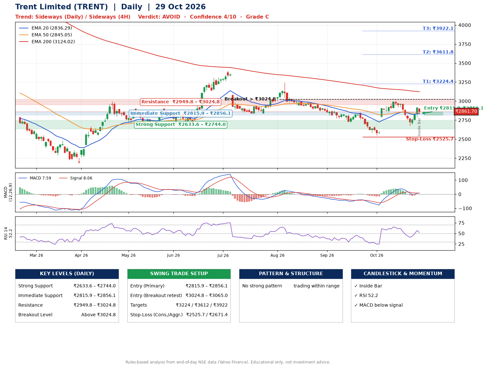

📌 **Trent Limited (TRENT) – Multi-Timeframe Technical Analysis (Daily + 4H Combined)**
_Data up to 29 Oct 2026 · Close ₹2861.70_

**📍 Daily Timeframe Trend**
- Trend: **Sideways** (mixed swing structure)
- Recent swing highs: ₹3244.5, ₹2847.9, ₹3004.7 · swing lows: ₹2836.0, ₹2723.9, ₹2545.8
- EMAs: EMA20 ₹2836.3, EMA50 ₹2845.0, EMA200 ₹3124.0; bearish stack (EMA20 < EMA50 < EMA200); price above EMA20, EMA50
- MACD 7.59 below signal 8.06 (above zero), fresh bearish crossover; histogram rising
- RSI(14) 52.2; no divergence on the last two swings

**📍 4-Hour Timeframe Trend**
- Structure: **Sideways** (mixed swing structure)
- Pullback/support area: recent 4H swing lows ₹2855.0, ₹2676.8; EMA20 ₹2835.1
- EMA20/50: bullish stack (EMA20 > EMA50); price above EMA20, EMA50
- MACD 2.49 above signal -3.64 (above zero), fresh bullish crossover; histogram rising
- RSI(14) 53.1; Regular bearish divergence

**📍 Pattern Detection (Both Timeframes)**
- No strong pattern detected. Trading within range.

**📍 Candlestick Patterns (last 3 daily candles)**
- **Inside Bar** – 29 Oct: compression inside the prior range ₹2790.7–₹2913.9

**📍 Price Action Key Levels (Daily Structure)**

| Zone | Price Level (₹) | Context |
|------|-----------------|---------|
| Strong Support | ₹2633.6 – ₹2744.0 | Cluster of earlier swing lows (demand) |
| Immediate Support | ₹2815.9 – ₹2856.1 | Nearest swing-low / wick area |
| Resistance | ₹2949.8 – ₹3024.8 | Nearest swing-high supply |
| Breakout Level | Above ₹3024.8 | Swing continuation trigger (52-week high ₹4831.7) |

**📍 Swing Trade Setup**

🟢 **Entry Zone**
- Primary: ₹2815.9 – ₹2856.1 (daily support / EMA20 area; enter on a bullish 4H candle)
- Alternate: ₹3024.8 – ₹3065.0 (breakout retest)

🎯 **Profit Targets**
- T1: ₹3224.4
- T2: ₹3611.8
- T3: ₹3922.1

🛑 **Stop-Loss**
- Conservative: below daily swing low (₹2525.7)
- Aggressive: below 4H structure (₹2671.4)
- Risk per share ≈ ₹310.3; reward:risk to T1 ≈ 1.3

**📌 Strategy Notes**
- Higher timeframe: daily trend is sideways; only take longs while price holds above ₹2633.6.
- Entry timing: wait for a bullish 4H candle (engulfing/hammer) inside ₹2815.9 – ₹2856.1 rather than buying mid-range.
- EMA stacking: bearish stack (EMA20 < EMA50 < EMA200); price above EMA20, EMA50.
- Breakout rule: a daily close above ₹3024.8 with volume above its 20-day average (≈1,146,755) opens T2/T3.
- Momentum: RSI 52 – room to run; no divergence on the last two swings.
- Exit discipline: move the stop to entry once T1 is hit; book partial profits at each target.

**STEP 2 — Marked Up Chart**

**✅ Trade Validation Checklist**
- Trend + momentum aligned: No · Price at entry zone: No
- Stop defined (₹2525.7) · Reward:risk ≥ 1.5 to T1: No

## 📌 Final Verdict

Recommendation: **🔴 AVOID**

Confidence: **4/10**

Trade Quality: **C**

Reason:
• No strong edge from trend, momentum or patterns

Next Action:
• Avoid until the trend changes (reclaim EMA50 and a higher low)

_Rules-based analysis from end-of-day data. Educational only, not investment advice. Never place orders without your own confirmation._