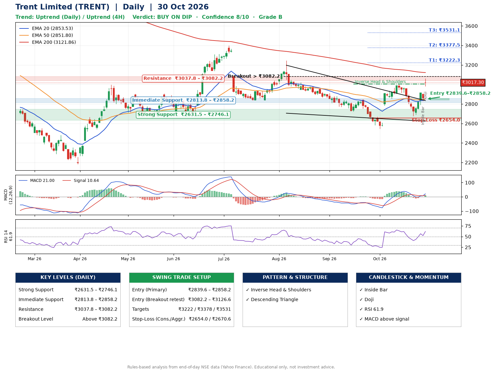

📌 **Trent Limited (TRENT) – Multi-Timeframe Technical Analysis (Daily + 4H Combined)**
_Data up to 30 Oct 2026 · Close ₹3017.30_

**📍 Daily Timeframe Trend**
- Trend: **Uptrend** (higher highs and higher lows)
- Recent swing highs: ₹3244.5, ₹2847.9, ₹3004.7 · swing lows: ₹2723.9, ₹2545.8, ₹2676.2
- EMAs: EMA20 ₹2853.5, EMA50 ₹2851.8, EMA200 ₹3121.9; mixed / crossing; price above EMA20, EMA50
- MACD 21.00 above signal 10.64 (above zero), fresh bullish crossover; histogram rising
- RSI(14) 61.9; no divergence on the last two swings

**📍 4-Hour Timeframe Trend**
- Structure: **Uptrend** (price above rising EMAs)
- Pullback/support area: recent 4H swing lows ₹2855.0, ₹2676.8; EMA20 ₹2869.5
- EMA20/50: bullish stack (EMA20 > EMA50); price above EMA20, EMA50
- MACD 28.70 above signal 6.29 (above zero), fresh bullish crossover; histogram rising
- RSI(14) 64.3; Regular bearish divergence

**📍 Pattern Detection (Both Timeframes)**
- Daily: **Inverse Head & Shoulders** – head ₹2545.8, neckline ₹3004.7
- Daily: **Descending Triangle** – converging swing highs and lows over the last ~60 sessions

**📍 Candlestick Patterns (last 3 daily candles)**
- **Inside Bar** – 29 Oct: compression inside the prior range ₹2790.7–₹2913.9
- **Doji** – 30 Oct: indecision; wait for the next candle to confirm direction

**📍 Price Action Key Levels (Daily Structure)**

| Zone | Price Level (₹) | Context |
|------|-----------------|---------|
| Strong Support | ₹2631.5 – ₹2746.1 | Cluster of earlier swing lows (demand) |
| Immediate Support | ₹2813.8 – ₹2858.2 | Nearest swing-low / wick area |
| Resistance | ₹3037.8 – ₹3082.2 | Nearest swing-high supply |
| Breakout Level | Above ₹3082.2 | Swing continuation trigger (52-week high ₹4828.4) |

**📍 Swing Trade Setup**

🟢 **Entry Zone**
- Primary: ₹2839.6 – ₹2858.2 (daily support / EMA20 area; enter on a bullish 4H candle)
- Alternate: ₹3082.2 – ₹3126.6 (breakout retest)

🎯 **Profit Targets**
- T1: ₹3222.3
- T2: ₹3377.5
- T3: ₹3531.1

🛑 **Stop-Loss**
- Conservative: below daily swing low (₹2654.0)
- Aggressive: below 4H structure (₹2670.6)
- Risk per share ≈ ₹194.9; reward:risk to T1 ≈ 1.9

**📌 Strategy Notes**
- Higher timeframe: daily trend is uptrend; only take longs while price holds above ₹2631.5.
- Entry timing: wait for a bullish 4H candle (engulfing/hammer) inside ₹2839.6 – ₹2858.2 rather than buying mid-range.
- EMA stacking: mixed / crossing; price above EMA20, EMA50.
- Breakout rule: a daily close above ₹3082.2 with volume above its 20-day average (≈1,329,011) opens T2/T3.
- Momentum: RSI 62 – room to run; no divergence on the last two swings.
- Exit discipline: move the stop to entry once T1 is hit; book partial profits at each target.

**STEP 2 — Marked Up Chart**

**✅ Trade Validation Checklist**
- Trend + momentum aligned: Yes · Price at entry zone: No
- Stop defined (₹2654.0) · Reward:risk ≥ 1.5 to T1: Yes

## 📌 Final Verdict

Recommendation: **🟡 BUY ON DIP**

Confidence: **8/10**

Trade Quality: **B**

Reason:
• Daily uptrend (higher highs and higher lows)
• Inverse Head & Shoulders: head ₹2545.8, neckline ₹3004.7

Next Action:
• Wait for a pullback to ₹2839.6–₹2858.2

_Rules-based analysis from end-of-day data. Educational only, not investment advice. Never place orders without your own confirmation._