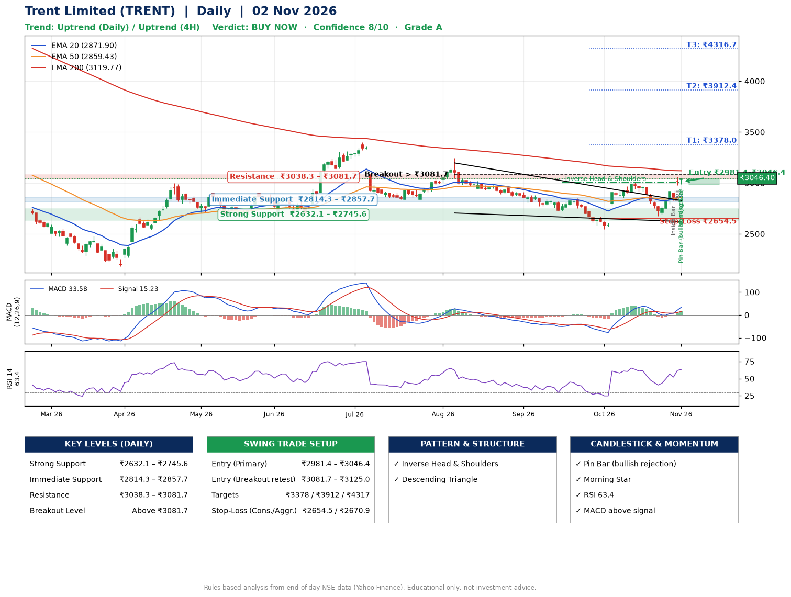

📌 **Trent Limited (TRENT) – Multi-Timeframe Technical Analysis (Daily + 4H Combined)**
_Data up to 02 Nov 2026 · Close ₹3046.40_

**📍 Daily Timeframe Trend**
- Trend: **Uptrend** (higher highs and higher lows)
- Recent swing highs: ₹3244.5, ₹2847.9, ₹3004.7 · swing lows: ₹2723.9, ₹2545.8, ₹2676.2
- EMAs: EMA20 ₹2871.9, EMA50 ₹2859.4, EMA200 ₹3119.8; mixed / crossing; price above EMA20, EMA50
- MACD 33.58 above signal 15.23 (above zero), fresh bullish crossover; histogram rising
- RSI(14) 63.4; no divergence on the last two swings

**📍 4-Hour Timeframe Trend**
- Structure: **Uptrend** (price above rising EMAs)
- Pullback/support area: recent 4H swing lows ₹2855.0, ₹2676.8; EMA20 ₹2899.5
- EMA20/50: bullish stack (EMA20 > EMA50); price above EMA20, EMA50
- MACD 45.25 above signal 19.02 (above zero); histogram rising
- RSI(14) 66.2; Regular bearish divergence

**📍 Pattern Detection (Both Timeframes)**
- Daily: **Inverse Head & Shoulders** – head ₹2545.8, neckline ₹3004.7
- Daily: **Descending Triangle** – converging swing highs and lows over the last ~60 sessions
- 4H: **Double Top** – tops near ₹3004.6/₹3059.9, neckline ₹2676.8, forming

**📍 Candlestick Patterns (last 3 daily candles)**
- **Inside Bar** – 29 Oct: compression inside the prior range ₹2790.7–₹2913.9
- **Doji** – 30 Oct: indecision; wait for the next candle to confirm direction
- **Pin Bar (bullish rejection)** – 02 Nov: long lower wick shows dip-buying near ₹2990.0
- **Morning Star** – 02 Nov: three-candle bullish reversal

**📍 Price Action Key Levels (Daily Structure)**

| Zone | Price Level (₹) | Context |
|------|-----------------|---------|
| Strong Support | ₹2632.1 – ₹2745.6 | Cluster of earlier swing lows (demand) |
| Immediate Support | ₹2814.3 – ₹2857.7 | Nearest swing-low / wick area |
| Resistance | ₹3038.3 – ₹3081.7 | Nearest swing-high supply |
| Breakout Level | Above ₹3081.7 | Swing continuation trigger (52-week high ₹4788.0) |

**📍 Swing Trade Setup**

🟢 **Entry Zone**
- Primary: ₹2981.4 – ₹3046.4 (daily support / EMA20 area; enter on a bullish 4H candle)
- Alternate: ₹3081.7 – ₹3125.0 (breakout retest)

🎯 **Profit Targets**
- T1: ₹3378.0
- T2: ₹3912.4
- T3: ₹4316.7

🛑 **Stop-Loss**
- Conservative: below daily swing low (₹2654.5)
- Aggressive: below 4H structure (₹2670.9)
- Risk per share ≈ ₹359.4; reward:risk to T1 ≈ 1.0

**📌 Strategy Notes**
- Higher timeframe: daily trend is uptrend; only take longs while price holds above ₹2632.1.
- Entry timing: wait for a bullish 4H candle (engulfing/hammer) inside ₹2981.4 – ₹3046.4 rather than buying mid-range.
- EMA stacking: mixed / crossing; price above EMA20, EMA50.
- Breakout rule: a daily close above ₹3081.7 with volume above its 20-day average (≈1,333,988) opens T2/T3.
- Momentum: RSI 63 – room to run; no divergence on the last two swings.
- Exit discipline: move the stop to entry once T1 is hit; book partial profits at each target.

**STEP 2 — Marked Up Chart**

**✅ Trade Validation Checklist**
- Trend + momentum aligned: Yes · Price at entry zone: Yes
- Stop defined (₹2654.5) · Reward:risk ≥ 1.5 to T1: No

## 📌 Final Verdict

Recommendation: **🟢 BUY NOW**

Confidence: **8/10**

Trade Quality: **A**

Reason:
• Daily uptrend (higher highs and higher lows)
• Inverse Head & Shoulders: head ₹2545.8, neckline ₹3004.7

Next Action:
• Buy now within the entry zone, with the stop-loss in place

_Rules-based analysis from end-of-day data. Educational only, not investment advice. Never place orders without your own confirmation._