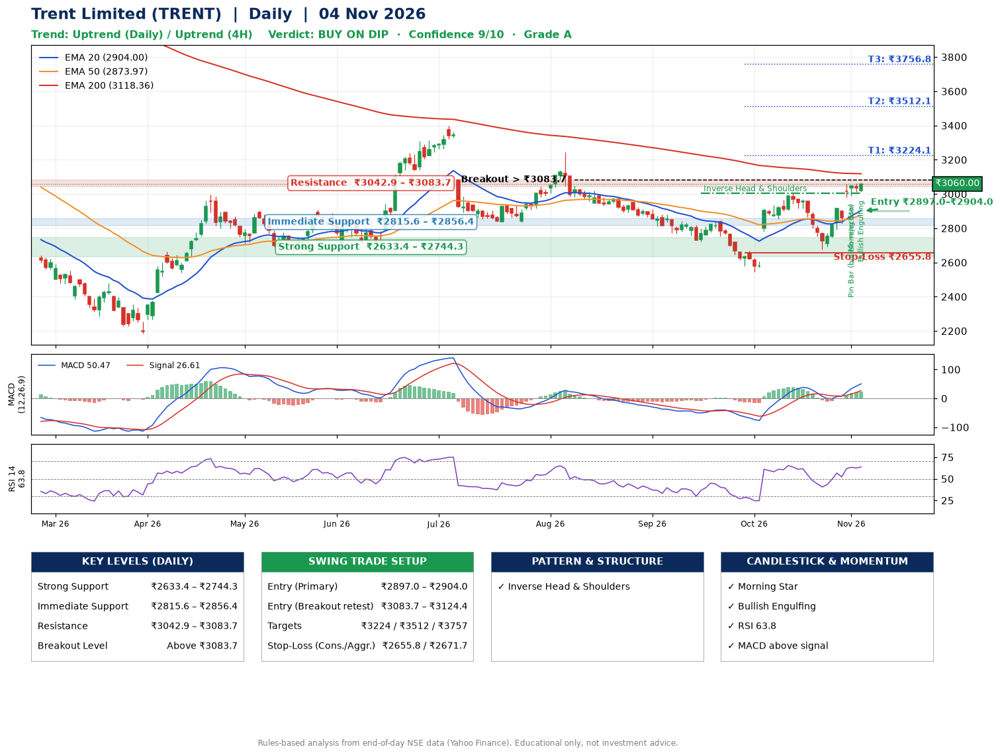

📌 **Trent Limited (TRENT) – Multi-Timeframe Technical Analysis (Daily + 4H Combined)**
_Data up to 04 Nov 2026 · Close ₹3060.00_

**📍 Daily Timeframe Trend**
- Trend: **Uptrend** (higher highs and higher lows)
- Recent swing highs: ₹3244.5, ₹2847.9, ₹3004.7 · swing lows: ₹2723.9, ₹2545.8, ₹2676.2
- EMAs: EMA20 ₹2904.0, EMA50 ₹2874.0, EMA200 ₹3118.4; mixed / crossing; price above EMA20, EMA50
- MACD 50.47 above signal 26.61 (above zero), fresh bullish crossover; histogram rising
- RSI(14) 63.8; no divergence on the last two swings

**📍 4-Hour Timeframe Trend**
- Structure: **Uptrend** (price above rising EMAs)
- Pullback/support area: recent 4H swing lows ₹2855.0, ₹2676.8; EMA20 ₹2946.8
- EMA20/50: bullish stack (EMA20 > EMA50); price above EMA20, EMA50
- MACD 58.69 above signal 40.33 (above zero); histogram falling
- RSI(14) 66.2; Regular bearish divergence

**📍 Pattern Detection (Both Timeframes)**
- Daily: **Inverse Head & Shoulders** – head ₹2545.8, neckline ₹3004.7

**📍 Candlestick Patterns (last 3 daily candles)**
- **Pin Bar (bullish rejection)** – 02 Nov: long lower wick shows dip-buying near ₹2990.0
- **Morning Star** – 02 Nov: three-candle bullish reversal
- **Bullish Engulfing** – 04 Nov: buyers fully reversed the prior red candle

**📍 Price Action Key Levels (Daily Structure)**

| Zone | Price Level (₹) | Context |
|------|-----------------|---------|
| Strong Support | ₹2633.4 – ₹2744.3 | Cluster of earlier swing lows (demand) |
| Immediate Support | ₹2815.6 – ₹2856.4 | Nearest swing-low / wick area |
| Resistance | ₹3042.9 – ₹3083.7 | Nearest swing-high supply |
| Breakout Level | Above ₹3083.7 | Swing continuation trigger (52-week high ₹4748.9) |

**📍 Swing Trade Setup**

🟢 **Entry Zone**
- Primary: ₹2897.0 – ₹2904.0 (daily support / EMA20 area; enter on a bullish 4H candle)
- Alternate: ₹3083.7 – ₹3124.4 (breakout retest)

🎯 **Profit Targets**
- T1: ₹3224.1
- T2: ₹3512.1
- T3: ₹3756.8

🛑 **Stop-Loss**
- Conservative: below daily swing low (₹2655.8)
- Aggressive: below 4H structure (₹2671.7)
- Risk per share ≈ ₹244.7; reward:risk to T1 ≈ 1.3

**📌 Strategy Notes**
- Higher timeframe: daily trend is uptrend; only take longs while price holds above ₹2633.4.
- Entry timing: wait for a bullish 4H candle (engulfing/hammer) inside ₹2897.0 – ₹2904.0 rather than buying mid-range.
- EMA stacking: mixed / crossing; price above EMA20, EMA50.
- Breakout rule: a daily close above ₹3083.7 with volume above its 20-day average (≈1,033,251) opens T2/T3.
- Momentum: RSI 64 – room to run; no divergence on the last two swings.
- Exit discipline: move the stop to entry once T1 is hit; book partial profits at each target.

**STEP 2 — Marked Up Chart**

**✅ Trade Validation Checklist**
- Trend + momentum aligned: Yes · Price at entry zone: No
- Stop defined (₹2655.8) · Reward:risk ≥ 1.5 to T1: No

## 📌 Final Verdict

Recommendation: **🟡 BUY ON DIP**

Confidence: **9/10**

Trade Quality: **A**

Reason:
• Daily uptrend (higher highs and higher lows)
• Inverse Head & Shoulders: head ₹2545.8, neckline ₹3004.7

Next Action:
• Wait for a pullback to ₹2897.0–₹2904.0

_Rules-based analysis from end-of-day data. Educational only, not investment advice. Never place orders without your own confirmation._