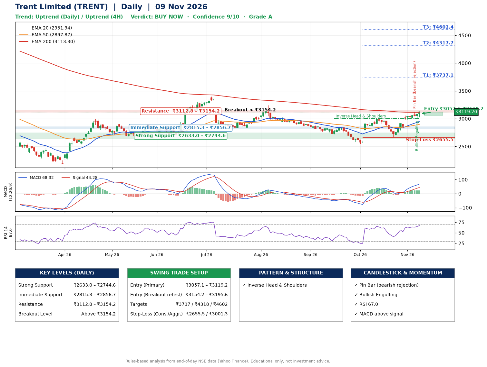

📌 **Trent Limited (TRENT) – Multi-Timeframe Technical Analysis (Daily + 4H Combined)**
_Data up to 09 Nov 2026 · Close ₹3119.20_

**📍 Daily Timeframe Trend**
- Trend: **Uptrend** (higher highs and higher lows)
- Recent swing highs: ₹3244.5, ₹2847.9, ₹3004.7 · swing lows: ₹2723.9, ₹2545.8, ₹2676.2
- EMAs: EMA20 ₹2951.3, EMA50 ₹2897.9, EMA200 ₹3113.3; mixed / crossing; price above EMA20, EMA50, EMA200
- MACD 68.32 above signal 44.28 (above zero); histogram rising
- RSI(14) 67.0; no divergence on the last two swings

**📍 4-Hour Timeframe Trend**
- Structure: **Uptrend** (price above rising EMAs)
- Pullback/support area: recent 4H swing lows ₹3013.2, ₹3006.6; EMA20 ₹3007.2
- EMA20/50: bullish stack (EMA20 > EMA50); price above EMA20, EMA50
- MACD 63.81 above signal 55.98 (above zero); histogram rising
- RSI(14) 71.2; Regular bullish divergence; Regular bearish divergence

**📍 Pattern Detection (Both Timeframes)**
- Daily: **Inverse Head & Shoulders** – head ₹2545.8, neckline ₹3004.7

**📍 Candlestick Patterns (last 3 daily candles)**
- **Pin Bar (bearish rejection)** – 05 Nov: long upper wick shows selling near ₹3130.0
- **Bullish Engulfing** – 06 Nov: buyers fully reversed the prior red candle

**📍 Price Action Key Levels (Daily Structure)**

| Zone | Price Level (₹) | Context |
|------|-----------------|---------|
| Strong Support | ₹2633.0 – ₹2744.6 | Cluster of earlier swing lows (demand) |
| Immediate Support | ₹2815.3 – ₹2856.7 | Nearest swing-low / wick area |
| Resistance | ₹3112.8 – ₹3154.2 | Nearest swing-high supply |
| Breakout Level | Above ₹3154.2 | Swing continuation trigger (52-week high ₹4708.1) |

**📍 Swing Trade Setup**

🟢 **Entry Zone**
- Primary: ₹3057.1 – ₹3119.2 (daily support / EMA20 area; enter on a bullish 4H candle)
- Alternate: ₹3154.2 – ₹3195.6 (breakout retest)

🎯 **Profit Targets**
- T1: ₹3737.1
- T2: ₹4317.7
- T3: ₹4602.4

🛑 **Stop-Loss**
- Conservative: below daily swing low (₹2655.5)
- Aggressive: below 4H structure (₹3001.3)
- Risk per share ≈ ₹432.6; reward:risk to T1 ≈ 1.5

**📌 Strategy Notes**
- Higher timeframe: daily trend is uptrend; only take longs while price holds above ₹2633.0.
- Entry timing: wait for a bullish 4H candle (engulfing/hammer) inside ₹3057.1 – ₹3119.2 rather than buying mid-range.
- EMA stacking: mixed / crossing; price above EMA20, EMA50, EMA200.
- Breakout rule: a daily close above ₹3154.2 with volume above its 20-day average (≈987,738) opens T2/T3.
- Momentum: RSI 67 – elevated, prefer dips; no divergence on the last two swings.
- Exit discipline: move the stop to entry once T1 is hit; book partial profits at each target.

**STEP 2 — Marked Up Chart**

**✅ Trade Validation Checklist**
- Trend + momentum aligned: Yes · Price at entry zone: Yes
- Stop defined (₹2655.5) · Reward:risk ≥ 1.5 to T1: No

## 📌 Final Verdict

Recommendation: **🟢 BUY NOW**

Confidence: **9/10**

Trade Quality: **A**

Reason:
• Daily uptrend (higher highs and higher lows)
• Inverse Head & Shoulders: head ₹2545.8, neckline ₹3004.7

Next Action:
• Buy now within the entry zone, with the stop-loss in place

_Rules-based analysis from end-of-day data. Educational only, not investment advice. Never place orders without your own confirmation._