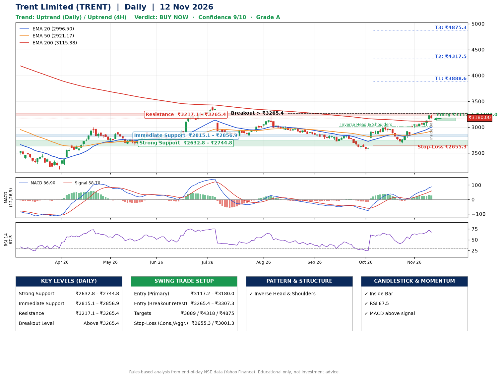

📌 **Trent Limited (TRENT) – Multi-Timeframe Technical Analysis (Daily + 4H Combined)**
_Data up to 12 Nov 2026 · Close ₹3180.00_

**📍 Daily Timeframe Trend**
- Trend: **Uptrend** (higher highs and higher lows)
- Recent swing highs: ₹3244.5, ₹2847.9, ₹3004.7 · swing lows: ₹2723.9, ₹2545.8, ₹2676.2
- EMAs: EMA20 ₹2996.5, EMA50 ₹2921.2, EMA200 ₹3115.4; mixed / crossing; price above EMA20, EMA50, EMA200
- MACD 86.90 above signal 58.70 (above zero); histogram falling
- RSI(14) 67.5; no divergence on the last two swings

**📍 4-Hour Timeframe Trend**
- Structure: **Uptrend** (price above rising EMAs)
- Pullback/support area: recent 4H swing lows ₹3013.2, ₹3006.6; EMA20 ₹3072.3
- EMA20/50: bullish stack (EMA20 > EMA50); price above EMA20, EMA50
- MACD 80.95 above signal 69.96 (above zero); histogram falling
- RSI(14) 69.2; Regular bullish divergence

**📍 Pattern Detection (Both Timeframes)**
- Daily: **Inverse Head & Shoulders** – head ₹2545.8, neckline ₹3004.7

**📍 Candlestick Patterns (last 3 daily candles)**
- **Inside Bar** – 12 Nov: compression inside the prior range ₹3135.0–₹3238.0

**📍 Price Action Key Levels (Daily Structure)**

| Zone | Price Level (₹) | Context |
|------|-----------------|---------|
| Strong Support | ₹2632.8 – ₹2744.8 | Cluster of earlier swing lows (demand) |
| Immediate Support | ₹2815.1 – ₹2856.9 | Nearest swing-low / wick area |
| Resistance | ₹3217.1 – ₹3265.4 | Nearest swing-high supply |
| Breakout Level | Above ₹3265.4 | Swing continuation trigger (52-week high ₹4579.9) |

**📍 Swing Trade Setup**

🟢 **Entry Zone**
- Primary: ₹3117.2 – ₹3180.0 (daily support / EMA20 area; enter on a bullish 4H candle)
- Alternate: ₹3265.4 – ₹3307.3 (breakout retest)

🎯 **Profit Targets**
- T1: ₹3888.6
- T2: ₹4317.5
- T3: ₹4875.3

🛑 **Stop-Loss**
- Conservative: below daily swing low (₹2655.3)
- Aggressive: below 4H structure (₹3001.3)
- Risk per share ≈ ₹493.3; reward:risk to T1 ≈ 1.5
- Time to T1: about 31 trading days (it rose this much within 60 trading days 9% of the time in the last 2 years)
- Time to T2: about 55 trading days (it rose this much within 60 trading days 2% of the time in the last 2 years)

**📌 Strategy Notes**
- Higher timeframe: daily trend is uptrend; only take longs while price holds above ₹2632.8.
- Entry timing: wait for a bullish 4H candle (engulfing/hammer) inside ₹3117.2 – ₹3180.0 rather than buying mid-range.
- EMA stacking: mixed / crossing; price above EMA20, EMA50, EMA200.
- Breakout rule: a daily close above ₹3265.4 with volume above its 20-day average (≈1,020,040) opens T2/T3.
- Momentum: RSI 68 – elevated, prefer dips; no divergence on the last two swings.
- Exit discipline: move the stop to entry once T1 is hit; book partial profits at each target.

**STEP 2 — Marked Up Chart**

**✅ Trade Validation Checklist**
- Trend + momentum aligned: Yes · Price at entry zone: Yes
- Stop defined (₹2655.3) · Reward:risk ≥ 1.5 to T1: Yes

## 📌 Final Verdict

Recommendation: **🟢 BUY NOW**

Confidence: **9/10**

Trade Quality: **A**

Reason:
• Daily uptrend (higher highs and higher lows)
• Inverse Head & Shoulders: head ₹2545.8, neckline ₹3004.7

Next Action:
• Buy now within the entry zone, with the stop-loss in place

_Rules-based analysis from end-of-day data. Educational only, not investment advice. Never place orders without your own confirmation._