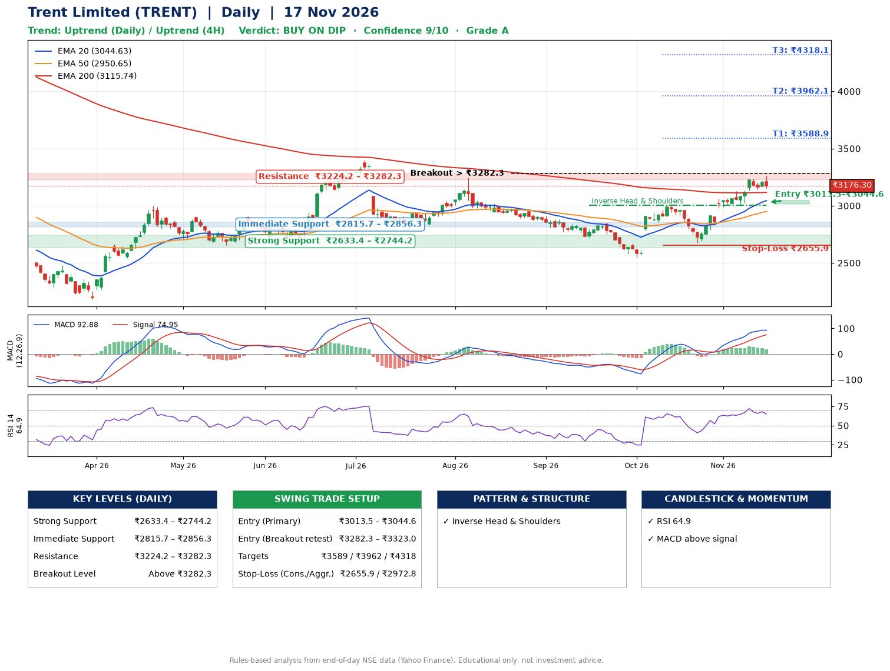

📌 **Trent Limited (TRENT) – Multi-Timeframe Technical Analysis (Daily + 4H Combined)**
_Data up to 17 Nov 2026 · Close ₹3176.30_

**📍 Daily Timeframe Trend**
- Trend: **Uptrend** (higher highs and higher lows)
- Recent swing highs: ₹3244.5, ₹2847.9, ₹3004.7 · swing lows: ₹2723.9, ₹2545.8, ₹2676.2
- EMAs: EMA20 ₹3044.6, EMA50 ₹2950.7, EMA200 ₹3115.7; mixed / crossing; price above EMA20, EMA50, EMA200
- MACD 92.88 above signal 74.95 (above zero); histogram falling
- RSI(14) 64.9; no divergence on the last two swings

**📍 4-Hour Timeframe Trend**
- Structure: **Uptrend** (higher highs and higher lows)
- Pullback/support area: recent 4H swing lows ₹3006.6, ₹3145.2; EMA20 ₹3124.0
- EMA20/50: bullish stack (EMA20 > EMA50); price above EMA20, EMA50
- MACD 68.46 below signal 71.88 (above zero), fresh bearish crossover; histogram falling
- RSI(14) 63.1; no divergence

**📍 Pattern Detection (Both Timeframes)**
- Daily: **Inverse Head & Shoulders** – head ₹2545.8, neckline ₹3004.7
- 4H: **Bull Flag** – 17% pole then a tight 4% flag; trigger above ₹3260.0

**📍 Candlestick Patterns (last 3 daily candles)**
- No notable candlestick signal in the last 3 sessions.

**📍 Price Action Key Levels (Daily Structure)**

| Zone | Price Level (₹) | Context |
|------|-----------------|---------|
| Strong Support | ₹2633.4 – ₹2744.2 | Cluster of earlier swing lows (demand) |
| Immediate Support | ₹2815.7 – ₹2856.3 | Nearest swing-low / wick area |
| Resistance | ₹3224.2 – ₹3282.3 | Nearest swing-high supply |
| Breakout Level | Above ₹3282.3 | Swing continuation trigger (52-week high ₹4417.8) |

**📍 Swing Trade Setup**

🟢 **Entry Zone**
- Primary: ₹3013.5 – ₹3044.6 (daily support / EMA20 area; enter on a bullish 4H candle)
- Alternate: ₹3282.3 – ₹3323.0 (breakout retest)

🎯 **Profit Targets**
- T1: ₹3588.9
- T2: ₹3962.1
- T3: ₹4318.1

🛑 **Stop-Loss**
- Conservative: below daily swing low (₹2655.9)
- Aggressive: below 4H structure (₹2972.8)
- Risk per share ≈ ₹373.2; reward:risk to T1 ≈ 1.5
- Time to T1: about 31 trading days (it rose this much within 60 trading days 22% of the time in the last 2 years)
- Time to T2: about 53 trading days (it rose this much within 60 trading days 4% of the time in the last 2 years)

**📌 Strategy Notes**
- Higher timeframe: daily trend is uptrend; only take longs while price holds above ₹2633.4.
- Entry timing: wait for a bullish 4H candle (engulfing/hammer) inside ₹3013.5 – ₹3044.6 rather than buying mid-range.
- EMA stacking: mixed / crossing; price above EMA20, EMA50, EMA200.
- Breakout rule: a daily close above ₹3282.3 with volume above its 20-day average (≈1,007,126) opens T2/T3.
- Momentum: RSI 65 – room to run; no divergence on the last two swings.
- Exit discipline: move the stop to entry once T1 is hit; book partial profits at each target.

**STEP 2 — Marked Up Chart**

**✅ Trade Validation Checklist**
- Trend + momentum aligned: Yes · Price at entry zone: No
- Stop defined (₹2655.9) · Reward:risk ≥ 1.5 to T1: No

## 📌 Final Verdict

Recommendation: **🟡 BUY ON DIP**

Confidence: **9/10**

Trade Quality: **A**

Reason:
• Daily uptrend (higher highs and higher lows)
• Inverse Head & Shoulders: head ₹2545.8, neckline ₹3004.7

Next Action:
• Wait for a pullback to ₹3013.5–₹3044.6

_Rules-based analysis from end-of-day data. Educational only, not investment advice. Never place orders without your own confirmation._