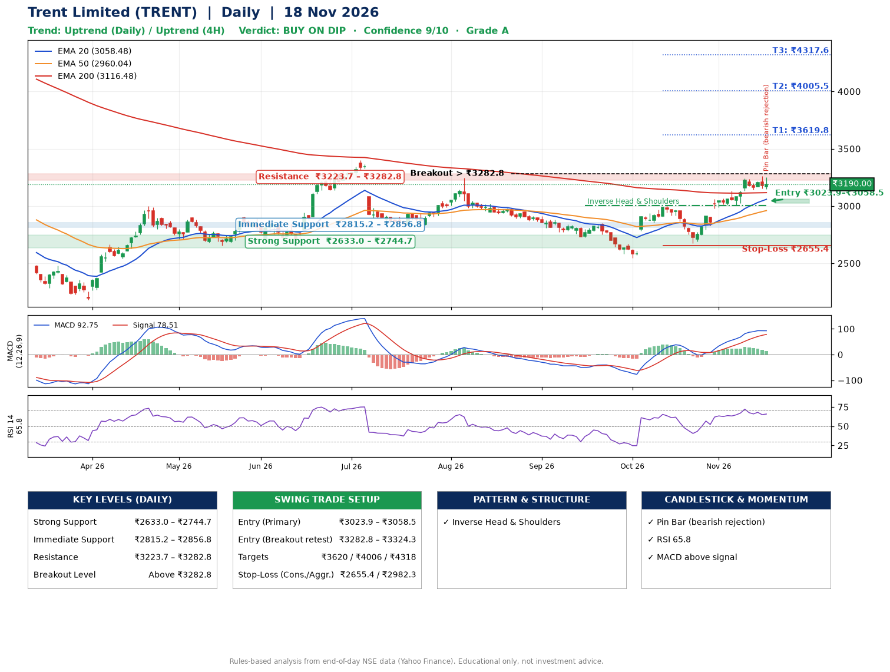

📌 **Trent Limited (TRENT) – Multi-Timeframe Technical Analysis (Daily + 4H Combined)**
_Data up to 18 Nov 2026 · Close ₹3190.00_

**📍 Daily Timeframe Trend**
- Trend: **Uptrend** (higher highs and higher lows)
- Recent swing highs: ₹3244.5, ₹2847.9, ₹3004.7 · swing lows: ₹2723.9, ₹2545.8, ₹2676.2
- EMAs: EMA20 ₹3058.5, EMA50 ₹2960.0, EMA200 ₹3116.5; mixed / crossing; price above EMA20, EMA50, EMA200
- MACD 92.75 above signal 78.51 (above zero); histogram falling
- RSI(14) 65.8; no divergence on the last two swings

**📍 4-Hour Timeframe Trend**
- Structure: **Uptrend** (higher highs and higher lows)
- Pullback/support area: recent 4H swing lows ₹3006.6, ₹3145.2; EMA20 ₹3136.5
- EMA20/50: bullish stack (EMA20 > EMA50); price above EMA20, EMA50
- MACD 62.72 below signal 69.10 (above zero), fresh bearish crossover; histogram falling
- RSI(14) 64.0; Regular bearish divergence

**📍 Pattern Detection (Both Timeframes)**
- Daily: **Inverse Head & Shoulders** – head ₹2545.8, neckline ₹3004.7
- 4H: **Bull Flag** – 15% pole then a tight 4% flag; trigger above ₹3260.0

**📍 Candlestick Patterns (last 3 daily candles)**
- **Pin Bar (bearish rejection)** – 18 Nov: long upper wick shows selling near ₹3251.3

**📍 Price Action Key Levels (Daily Structure)**

| Zone | Price Level (₹) | Context |
|------|-----------------|---------|
| Strong Support | ₹2633.0 – ₹2744.7 | Cluster of earlier swing lows (demand) |
| Immediate Support | ₹2815.2 – ₹2856.8 | Nearest swing-low / wick area |
| Resistance | ₹3223.7 – ₹3282.8 | Nearest swing-high supply |
| Breakout Level | Above ₹3282.8 | Swing continuation trigger (52-week high ₹4417.8) |

**📍 Swing Trade Setup**

🟢 **Entry Zone**
- Primary: ₹3023.9 – ₹3058.5 (daily support / EMA20 area; enter on a bullish 4H candle)
- Alternate: ₹3282.8 – ₹3324.3 (breakout retest)

🎯 **Profit Targets**
- T1: ₹3619.8
- T2: ₹4005.5
- T3: ₹4317.6

🛑 **Stop-Loss**
- Conservative: below daily swing low (₹2655.4)
- Aggressive: below 4H structure (₹2982.3)
- Risk per share ≈ ₹385.7; reward:risk to T1 ≈ 1.5
- Time to T1: about 28 trading days (it rose this much within 60 trading days 19% of the time in the last 2 years)
- Time to T2: about 52 trading days (it rose this much within 60 trading days 3% of the time in the last 2 years)

**📌 Strategy Notes**
- Higher timeframe: daily trend is uptrend; only take longs while price holds above ₹2633.0.
- Entry timing: wait for a bullish 4H candle (engulfing/hammer) inside ₹3023.9 – ₹3058.5 rather than buying mid-range.
- EMA stacking: mixed / crossing; price above EMA20, EMA50, EMA200.
- Breakout rule: a daily close above ₹3282.8 with volume above its 20-day average (≈1,031,768) opens T2/T3.
- Momentum: RSI 66 – elevated, prefer dips; no divergence on the last two swings.
- Exit discipline: move the stop to entry once T1 is hit; book partial profits at each target.

**STEP 2 — Marked Up Chart**

**✅ Trade Validation Checklist**
- Trend + momentum aligned: Yes · Price at entry zone: No
- Stop defined (₹2655.4) · Reward:risk ≥ 1.5 to T1: Yes

## 📌 Final Verdict

Recommendation: **🟡 BUY ON DIP**

Confidence: **9/10**

Trade Quality: **A**

Reason:
• Daily uptrend (higher highs and higher lows)
• Inverse Head & Shoulders: head ₹2545.8, neckline ₹3004.7

Next Action:
• Wait for a pullback to ₹3023.9–₹3058.5

_Rules-based analysis from end-of-day data. Educational only, not investment advice. Never place orders without your own confirmation._