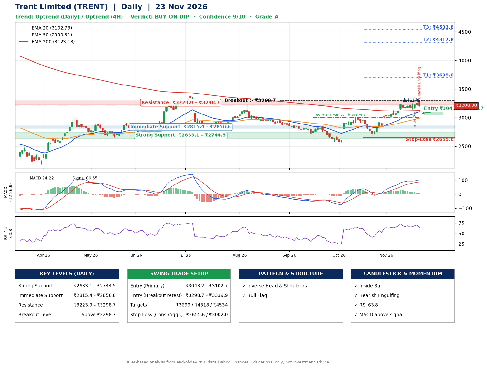

📌 **Trent Limited (TRENT) – Multi-Timeframe Technical Analysis (Daily + 4H Combined)**
_Data up to 23 Nov 2026 · Close ₹3208.00_

**📍 Daily Timeframe Trend**
- Trend: **Uptrend** (higher highs and higher lows)
- Recent swing highs: ₹3244.5, ₹2847.9, ₹3004.7 · swing lows: ₹2723.9, ₹2545.8, ₹2676.2
- EMAs: EMA20 ₹3102.7, EMA50 ₹2990.5, EMA200 ₹3123.1; mixed / crossing; price above EMA20, EMA50, EMA200
- MACD 94.22 above signal 86.65 (above zero); histogram falling
- RSI(14) 63.8; no divergence on the last two swings

**📍 4-Hour Timeframe Trend**
- Structure: **Uptrend** (higher highs and higher lows)
- Pullback/support area: recent 4H swing lows ₹3145.2, ₹3146.8; EMA20 ₹3176.4
- EMA20/50: bullish stack (EMA20 > EMA50); price above EMA20, EMA50
- MACD 52.96 below signal 60.84 (above zero); histogram falling
- RSI(14) 59.9; Hidden bullish divergence; Regular bearish divergence

**📍 Pattern Detection (Both Timeframes)**
- Daily: **Inverse Head & Shoulders** – head ₹2545.8, neckline ₹3004.7
- Daily: **Bull Flag** – 17% pole then a tight 4% flag; trigger above ₹3278.1

**📍 Candlestick Patterns (last 3 daily candles)**
- **Inside Bar** – 19 Nov: compression inside the prior range ₹3146.5–₹3251.3
- **Bearish Engulfing** – 23 Nov: sellers fully reversed the prior green candle

**📍 Price Action Key Levels (Daily Structure)**

| Zone | Price Level (₹) | Context |
|------|-----------------|---------|
| Strong Support | ₹2633.1 – ₹2744.5 | Cluster of earlier swing lows (demand) |
| Immediate Support | ₹2815.4 – ₹2856.6 | Nearest swing-low / wick area |
| Resistance | ₹3223.9 – ₹3298.7 | Nearest swing-high supply |
| Breakout Level | Above ₹3298.7 | Swing continuation trigger (52-week high ₹4417.8) |

**📍 Swing Trade Setup**

🟢 **Entry Zone**
- Primary: ₹3043.2 – ₹3102.7 (daily support / EMA20 area; enter on a bullish 4H candle)
- Alternate: ₹3298.7 – ₹3339.9 (breakout retest)

🎯 **Profit Targets**
- T1: ₹3699.0
- T2: ₹4317.8
- T3: ₹4533.8

🛑 **Stop-Loss**
- Conservative: below daily swing low (₹2655.6)
- Aggressive: below 4H structure (₹3002.0)
- Risk per share ≈ ₹417.4; reward:risk to T1 ≈ 1.5
- Time to T1: about 29 trading days (it rose this much within 60 trading days 14% of the time in the last 2 years)
- Time to T2: about 56 trading days (it rose this much within 60 trading days 2% of the time in the last 2 years)

**📌 Strategy Notes**
- Higher timeframe: daily trend is uptrend; only take longs while price holds above ₹2633.1.
- Entry timing: wait for a bullish 4H candle (engulfing/hammer) inside ₹3043.2 – ₹3102.7 rather than buying mid-range.
- EMA stacking: mixed / crossing; price above EMA20, EMA50, EMA200.
- Breakout rule: a daily close above ₹3298.7 with volume above its 20-day average (≈999,784) opens T2/T3.
- Momentum: RSI 64 – room to run; no divergence on the last two swings.
- Exit discipline: move the stop to entry once T1 is hit; book partial profits at each target.

**STEP 2 — Marked Up Chart**

**✅ Trade Validation Checklist**
- Trend + momentum aligned: Yes · Price at entry zone: No
- Stop defined (₹2655.6) · Reward:risk ≥ 1.5 to T1: No

## 📌 Final Verdict

Recommendation: **🟡 BUY ON DIP**

Confidence: **9/10**

Trade Quality: **A**

Reason:
• Daily uptrend (higher highs and higher lows)
• Inverse Head & Shoulders: head ₹2545.8, neckline ₹3004.7

Next Action:
• Wait for a pullback to ₹3043.2–₹3102.7

_Rules-based analysis from end-of-day data. Educational only, not investment advice. Never place orders without your own confirmation._