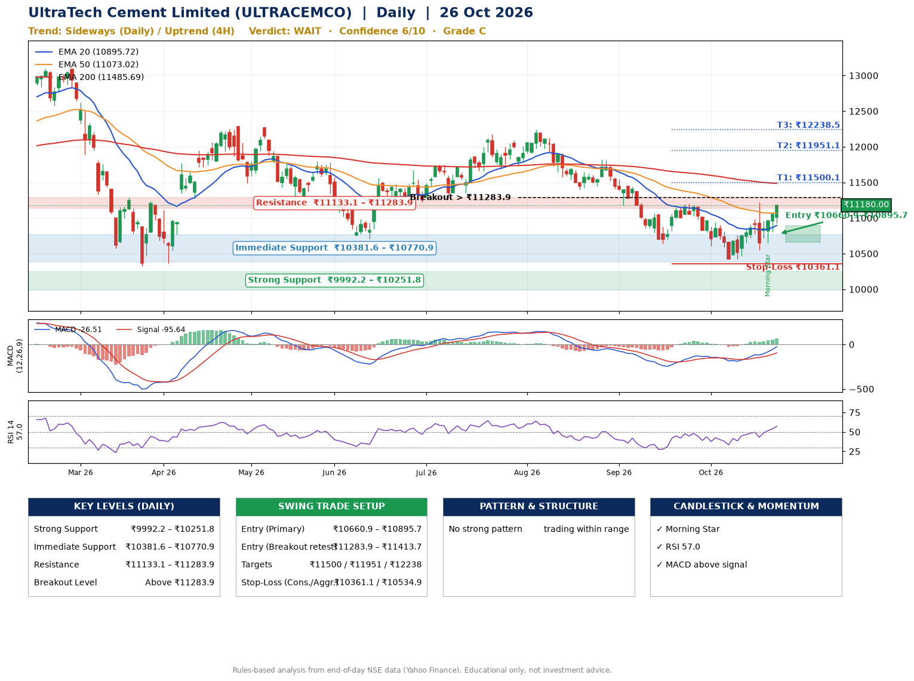

📌 **UltraTech Cement Limited (ULTRACEMCO) – Multi-Timeframe Technical Analysis (Daily + 4H Combined)**
_Data up to 26 Oct 2026 · Close ₹11180.00_

**📍 Daily Timeframe Trend**
- Trend: **Sideways** (mixed swing structure)
- Recent swing highs: ₹12239.0, ₹11820.0, ₹11198.0 · swing lows: ₹10639.0, ₹10426.0, ₹10426.0
- EMAs: EMA20 ₹10895.7, EMA50 ₹11073.0, EMA200 ₹11485.7; bearish stack (EMA20 < EMA50 < EMA200); price above EMA20, EMA50
- MACD -26.51 above signal -95.64 (below zero); histogram rising
- RSI(14) 57.0; no divergence on the last two swings

**📍 4-Hour Timeframe Trend**
- Structure: **Uptrend** (higher highs and higher lows)
- Pullback/support area: recent 4H swing lows ₹10444.0, ₹10552.0; EMA20 ₹10893.3
- EMA20/50: bearish stack (EMA20 < EMA50); price above EMA20, EMA50
- MACD 65.43 above signal 23.11 (above zero); histogram rising
- RSI(14) 63.2; no divergence

**📍 Pattern Detection (Both Timeframes)**
- 4H: **Double Bottom** – bottoms near ₹10444.0/₹10552.0, neckline ₹11214.0, forming

**📍 Candlestick Patterns (last 3 daily candles)**
- **Morning Star** – 22 Oct: three-candle bullish reversal

**📍 Price Action Key Levels (Daily Structure)**

| Zone | Price Level (₹) | Context |
|------|-----------------|---------|
| Strong Support | ₹9992.2 – ₹10251.8 | Cluster of earlier swing lows (demand) |
| Immediate Support | ₹10381.6 – ₹10770.9 | Nearest swing-low / wick area |
| Resistance | ₹11133.1 – ₹11283.9 | Nearest swing-high supply |
| Breakout Level | Above ₹11283.9 | Swing continuation trigger (52-week high ₹13110.0) |

**📍 Swing Trade Setup**

🟢 **Entry Zone**
- Primary: ₹10660.9 – ₹10895.7 (daily support / EMA20 area; enter on a bullish 4H candle)
- Alternate: ₹11283.9 – ₹11413.7 (breakout retest)

🎯 **Profit Targets**
- T1: ₹11500.1
- T2: ₹11951.1
- T3: ₹12238.5

🛑 **Stop-Loss**
- Conservative: below daily swing low (₹10361.1)
- Aggressive: below 4H structure (₹10534.9)
- Risk per share ≈ ₹417.2; reward:risk to T1 ≈ 1.7

**📌 Strategy Notes**
- Higher timeframe: daily trend is sideways; only take longs while price holds above ₹9992.2.
- Entry timing: wait for a bullish 4H candle (engulfing/hammer) inside ₹10660.9 – ₹10895.7 rather than buying mid-range.
- EMA stacking: bearish stack (EMA20 < EMA50 < EMA200); price above EMA20, EMA50.
- Breakout rule: a daily close above ₹11283.9 with volume above its 20-day average (≈306,336) opens T2/T3.
- Momentum: RSI 57 – room to run; no divergence on the last two swings.
- Exit discipline: move the stop to entry once T1 is hit; book partial profits at each target.

**STEP 2 — Marked Up Chart**

**✅ Trade Validation Checklist**
- Trend + momentum aligned: No · Price at entry zone: No
- Stop defined (₹10361.1) · Reward:risk ≥ 1.5 to T1: Yes

## 📌 Final Verdict

Recommendation: **🟠 WAIT**

Confidence: **6/10**

Trade Quality: **C**

Reason:
• No strong edge from trend, momentum or patterns

Next Action:
• Wait for a breakout above ₹11283.9

_Rules-based analysis from end-of-day data. Educational only, not investment advice. Never place orders without your own confirmation._