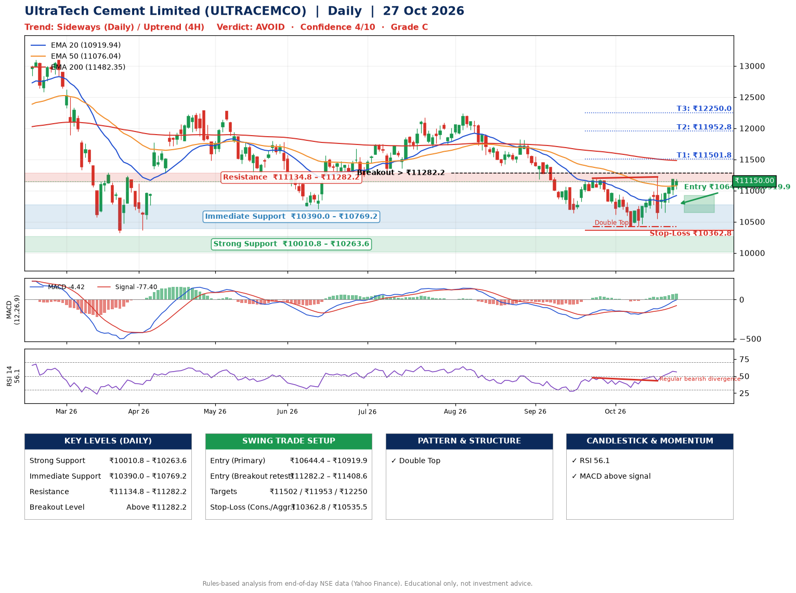

📌 **UltraTech Cement Limited (ULTRACEMCO) – Multi-Timeframe Technical Analysis (Daily + 4H Combined)**
_Data up to 27 Oct 2026 · Close ₹11150.00_

**📍 Daily Timeframe Trend**
- Trend: **Sideways** (mixed swing structure)
- Recent swing highs: ₹11820.0, ₹11198.0, ₹11219.0 · swing lows: ₹10639.0, ₹10426.0, ₹10426.0
- EMAs: EMA20 ₹10919.9, EMA50 ₹11076.0, EMA200 ₹11482.3; bearish stack (EMA20 < EMA50 < EMA200); price above EMA20, EMA50
- MACD -4.42 above signal -77.40 (below zero); histogram rising
- RSI(14) 56.1; Regular bearish divergence

**📍 4-Hour Timeframe Trend**
- Structure: **Uptrend** (higher highs and higher lows)
- Pullback/support area: recent 4H swing lows ₹10444.0, ₹10552.0; EMA20 ₹10934.8
- EMA20/50: bullish stack (EMA20 > EMA50); price above EMA20, EMA50
- MACD 81.52 above signal 42.64 (above zero); histogram falling
- RSI(14) 60.6; no divergence

**📍 Pattern Detection (Both Timeframes)**
- Daily: **Double Top** – tops near ₹11198.0/₹11219.0, neckline ₹10426.0, forming
- 4H: **Double Bottom** – bottoms near ₹10444.0/₹10552.0, neckline ₹11214.0, forming

**📍 Candlestick Patterns (last 3 daily candles)**
- No notable candlestick signal in the last 3 sessions.

**📍 Price Action Key Levels (Daily Structure)**

| Zone | Price Level (₹) | Context |
|------|-----------------|---------|
| Strong Support | ₹10010.8 – ₹10263.6 | Cluster of earlier swing lows (demand) |
| Immediate Support | ₹10390.0 – ₹10769.2 | Nearest swing-low / wick area |
| Resistance | ₹11134.8 – ₹11282.2 | Nearest swing-high supply |
| Breakout Level | Above ₹11282.2 | Swing continuation trigger (52-week high ₹13110.0) |

**📍 Swing Trade Setup**

🟢 **Entry Zone**
- Primary: ₹10644.4 – ₹10919.9 (daily support / EMA20 area; enter on a bullish 4H candle)
- Alternate: ₹11282.2 – ₹11408.6 (breakout retest)

🎯 **Profit Targets**
- T1: ₹11501.8
- T2: ₹11952.8
- T3: ₹12250.0

🛑 **Stop-Loss**
- Conservative: below daily swing low (₹10362.8)
- Aggressive: below 4H structure (₹10535.5)
- Risk per share ≈ ₹419.4; reward:risk to T1 ≈ 1.7

**📌 Strategy Notes**
- Higher timeframe: daily trend is sideways; only take longs while price holds above ₹10010.8.
- Entry timing: wait for a bullish 4H candle (engulfing/hammer) inside ₹10644.4 – ₹10919.9 rather than buying mid-range.
- EMA stacking: bearish stack (EMA20 < EMA50 < EMA200); price above EMA20, EMA50.
- Breakout rule: a daily close above ₹11282.2 with volume above its 20-day average (≈311,212) opens T2/T3.
- Momentum: RSI 56 – room to run; Regular bearish divergence.
- Exit discipline: move the stop to entry once T1 is hit; book partial profits at each target.

**STEP 2 — Marked Up Chart**

**✅ Trade Validation Checklist**
- Trend + momentum aligned: No · Price at entry zone: No
- Stop defined (₹10362.8) · Reward:risk ≥ 1.5 to T1: Yes

## 📌 Final Verdict

Recommendation: **🔴 AVOID**

Confidence: **4/10**

Trade Quality: **C**

Reason:
• Double Top: tops near ₹11198.0/₹11219.0, neckline ₹10426.0, forming

Next Action:
• Avoid until the trend changes (reclaim EMA50 and a higher low)

_Rules-based analysis from end-of-day data. Educational only, not investment advice. Never place orders without your own confirmation._