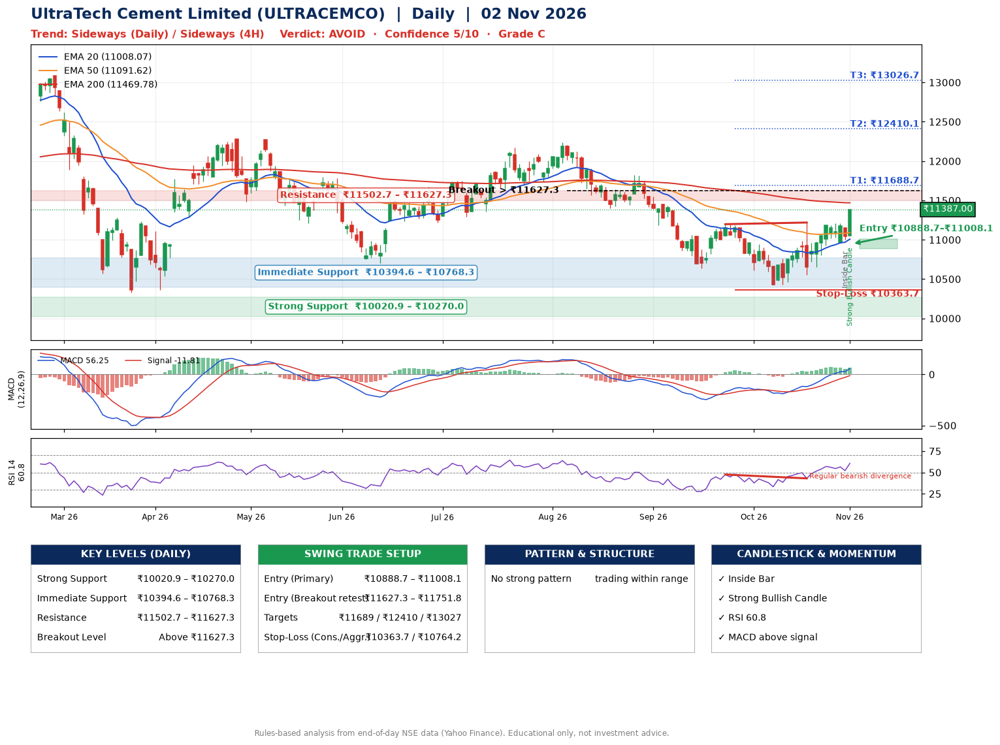

📌 **UltraTech Cement Limited (ULTRACEMCO) – Multi-Timeframe Technical Analysis (Daily + 4H Combined)**
_Data up to 02 Nov 2026 · Close ₹11387.00_

**📍 Daily Timeframe Trend**
- Trend: **Sideways** (mixed swing structure)
- Recent swing highs: ₹11820.0, ₹11198.0, ₹11219.0 · swing lows: ₹10639.0, ₹10426.0, ₹10426.0
- EMAs: EMA20 ₹11008.1, EMA50 ₹11091.6, EMA200 ₹11469.8; bearish stack (EMA20 < EMA50 < EMA200); price above EMA20, EMA50
- MACD 56.25 above signal -11.81 (above zero); histogram rising
- RSI(14) 60.8; Regular bearish divergence

**📍 4-Hour Timeframe Trend**
- Structure: **Sideways** (mixed swing structure)
- Pullback/support area: recent 4H swing lows ₹10552.0, ₹11013.0; EMA20 ₹11072.8
- EMA20/50: bullish stack (EMA20 > EMA50); price above EMA20, EMA50
- MACD 105.41 above signal 84.21 (above zero); histogram rising
- RSI(14) 65.2; Hidden bearish divergence

**📍 Pattern Detection (Both Timeframes)**
- No strong pattern detected. Trading within range.

**📍 Candlestick Patterns (last 3 daily candles)**
- **Inside Bar** – 30 Oct: compression inside the prior range ₹10967.0–₹11205.0
- **Strong Bullish Candle** – 02 Nov: wide-range green candle, buyers in control

**📍 Price Action Key Levels (Daily Structure)**

| Zone | Price Level (₹) | Context |
|------|-----------------|---------|
| Strong Support | ₹10020.9 – ₹10270.0 | Cluster of earlier swing lows (demand) |
| Immediate Support | ₹10394.6 – ₹10768.3 | Nearest swing-low / wick area |
| Resistance | ₹11502.7 – ₹11627.3 | Nearest swing-high supply |
| Breakout Level | Above ₹11627.3 | Swing continuation trigger (52-week high ₹13110.0) |

**📍 Swing Trade Setup**

🟢 **Entry Zone**
- Primary: ₹10888.7 – ₹11008.1 (daily support / EMA20 area; enter on a bullish 4H candle)
- Alternate: ₹11627.3 – ₹11751.8 (breakout retest)

🎯 **Profit Targets**
- T1: ₹11688.7
- T2: ₹12410.1
- T3: ₹13026.7

🛑 **Stop-Loss**
- Conservative: below daily swing low (₹10363.7)
- Aggressive: below 4H structure (₹10764.2)
- Risk per share ≈ ₹584.7; reward:risk to T1 ≈ 1.3

**📌 Strategy Notes**
- Higher timeframe: daily trend is sideways; only take longs while price holds above ₹10020.9.
- Entry timing: wait for a bullish 4H candle (engulfing/hammer) inside ₹10888.7 – ₹11008.1 rather than buying mid-range.
- EMA stacking: bearish stack (EMA20 < EMA50 < EMA200); price above EMA20, EMA50.
- Breakout rule: a daily close above ₹11627.3 with volume above its 20-day average (≈266,457) opens T2/T3.
- Momentum: RSI 61 – room to run; Regular bearish divergence.
- Exit discipline: move the stop to entry once T1 is hit; book partial profits at each target.

**STEP 2 — Marked Up Chart**

**✅ Trade Validation Checklist**
- Trend + momentum aligned: No · Price at entry zone: No
- Stop defined (₹10363.7) · Reward:risk ≥ 1.5 to T1: No

## 📌 Final Verdict

Recommendation: **🔴 AVOID**

Confidence: **5/10**

Trade Quality: **C**

Reason:
• No strong edge from trend, momentum or patterns

Next Action:
• Avoid until the trend changes (reclaim EMA50 and a higher low)

_Rules-based analysis from end-of-day data. Educational only, not investment advice. Never place orders without your own confirmation._