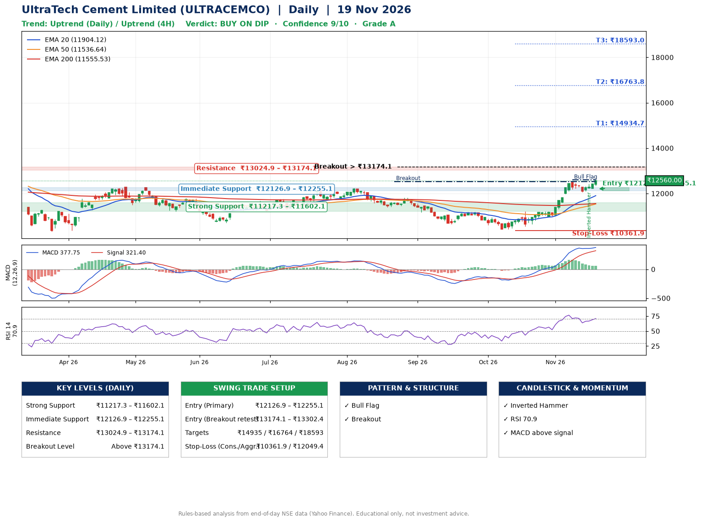

📌 **UltraTech Cement Limited (ULTRACEMCO) – Multi-Timeframe Technical Analysis (Daily + 4H Combined)**
_Data up to 19 Nov 2026 · Close ₹12560.00_

**📍 Daily Timeframe Trend**
- Trend: **Uptrend** (price above rising EMAs)
- Recent swing highs: ₹11198.0, ₹11219.0, ₹12532.0 · swing lows: ₹10639.0, ₹10426.0, ₹10426.0
- EMAs: EMA20 ₹11904.1, EMA50 ₹11536.6, EMA200 ₹11555.5; mixed / crossing; price above EMA20, EMA50, EMA200
- MACD 377.75 above signal 321.40 (above zero); histogram falling
- RSI(14) 70.9; no divergence on the last two swings

**📍 4-Hour Timeframe Trend**
- Structure: **Uptrend** (higher highs and higher lows)
- Pullback/support area: recent 4H swing lows ₹11013.0, ₹12065.0; EMA20 ₹12217.3
- EMA20/50: bullish stack (EMA20 > EMA50); price above EMA20, EMA50
- MACD 246.26 below signal 260.56 (above zero); histogram rising
- RSI(14) 69.4; no divergence

**📍 Pattern Detection (Both Timeframes)**
- Daily: **Bull Flag** – 17% pole then a tight 4% flag; trigger above ₹12595.0
- Daily: **Breakout** – closed above the 60-session high ₹12532.0 (volume not confirming yet)

**📍 Candlestick Patterns (last 3 daily candles)**
- **Inverted Hammer** – 17 Nov: long upper wick shows selling near ₹12425.0

**📍 Price Action Key Levels (Daily Structure)**

| Zone | Price Level (₹) | Context |
|------|-----------------|---------|
| Strong Support | ₹11217.3 – ₹11602.1 | Cluster of earlier swing lows (demand) |
| Immediate Support | ₹12126.9 – ₹12255.1 | Nearest swing-low / wick area |
| Resistance | ₹13024.9 – ₹13174.1 | Nearest swing-high supply |
| Breakout Level | Above ₹13174.1 | Swing continuation trigger (52-week high ₹13110.0) |

**📍 Swing Trade Setup**

🟢 **Entry Zone**
- Primary: ₹12126.9 – ₹12255.1 (daily support / EMA20 area; enter on a bullish 4H candle)
- Alternate: ₹13174.1 – ₹13302.4 (breakout retest)

🎯 **Profit Targets**
- T1: ₹14934.7
- T2: ₹16763.8
- T3: ₹18593.0

🛑 **Stop-Loss**
- Conservative: below daily swing low (₹10361.9)
- Aggressive: below 4H structure (₹12049.4)
- Risk per share ≈ ₹1829.1; reward:risk to T1 ≈ 1.5
- Time to T1: it never rose this much within 60 trading days in the price history
- Time to T2: it never rose this much within 60 trading days in the price history

**📌 Strategy Notes**
- Higher timeframe: daily trend is uptrend; only take longs while price holds above ₹11217.3.
- Entry timing: wait for a bullish 4H candle (engulfing/hammer) inside ₹12126.9 – ₹12255.1 rather than buying mid-range.
- EMA stacking: mixed / crossing; price above EMA20, EMA50, EMA200.
- Breakout rule: a daily close above ₹13174.1 with volume above its 20-day average (≈252,232) opens T2/T3.
- Momentum: RSI 71 – elevated, prefer dips; no divergence on the last two swings.
- Exit discipline: move the stop to entry once T1 is hit; book partial profits at each target.

**STEP 2 — Marked Up Chart**

**✅ Trade Validation Checklist**
- Trend + momentum aligned: Yes · Price at entry zone: No
- Stop defined (₹10361.9) · Reward:risk ≥ 1.5 to T1: No

## 📌 Final Verdict

Recommendation: **🟡 BUY ON DIP**

Confidence: **9/10**

Trade Quality: **A**

Reason:
• Daily uptrend (price above rising EMAs)
• Bull Flag: 17% pole then a tight 4% flag; trigger above ₹12595.0

Next Action:
• Wait for a pullback to ₹12126.9–₹12255.1, or a breakout above ₹13174.1

_Rules-based analysis from end-of-day data. Educational only, not investment advice. Never place orders without your own confirmation._