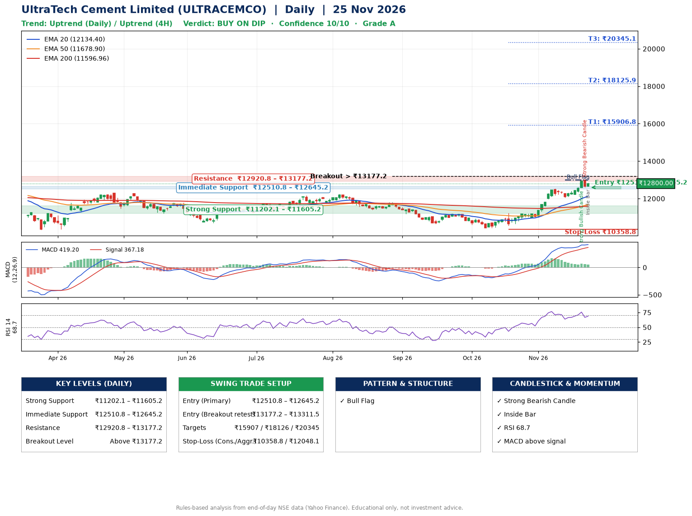

📌 **UltraTech Cement Limited (ULTRACEMCO) – Multi-Timeframe Technical Analysis (Daily + 4H Combined)**
_Data up to 25 Nov 2026 · Close ₹12800.00_

**📍 Daily Timeframe Trend**
- Trend: **Uptrend** (price above rising EMAs)
- Recent swing highs: ₹11198.0, ₹11219.0, ₹12532.0 · swing lows: ₹10639.0, ₹10426.0, ₹10426.0
- EMAs: EMA20 ₹12134.4, EMA50 ₹11678.9, EMA200 ₹11597.0; bullish stack (EMA20 > EMA50 > EMA200); price above EMA20, EMA50, EMA200
- MACD 419.20 above signal 367.18 (above zero); histogram falling
- RSI(14) 68.7; no divergence on the last two swings

**📍 4-Hour Timeframe Trend**
- Structure: **Uptrend** (higher highs and higher lows)
- Pullback/support area: recent 4H swing lows ₹11013.0, ₹12065.0; EMA20 ₹12458.3
- EMA20/50: bullish stack (EMA20 > EMA50); price above EMA20, EMA50
- MACD 258.24 below signal 263.24 (above zero), fresh bullish crossover; histogram rising
- RSI(14) 67.1; Regular bearish divergence

**📍 Pattern Detection (Both Timeframes)**
- Daily: **Bull Flag** – 16% pole then a tight 7% flag; trigger above ₹12988.0

**📍 Candlestick Patterns (last 3 daily candles)**
- **Strong Bullish Candle** – 20 Nov: wide-range green candle, buyers in control
- **Strong Bearish Candle** – 23 Nov: wide-range red candle, sellers in control
- **Inside Bar** – 25 Nov: compression inside the prior range ₹12612.0–₹12988.0

**📍 Price Action Key Levels (Daily Structure)**

| Zone | Price Level (₹) | Context |
|------|-----------------|---------|
| Strong Support | ₹11202.1 – ₹11605.2 | Cluster of earlier swing lows (demand) |
| Immediate Support | ₹12510.8 – ₹12645.2 | Nearest swing-low / wick area |
| Resistance | ₹12920.8 – ₹13177.2 | Nearest swing-high supply |
| Breakout Level | Above ₹13177.2 | Swing continuation trigger (52-week high ₹13110.0) |

**📍 Swing Trade Setup**

🟢 **Entry Zone**
- Primary: ₹12510.8 – ₹12645.2 (daily support / EMA20 area; enter on a bullish 4H candle)
- Alternate: ₹13177.2 – ₹13311.5 (breakout retest)

🎯 **Profit Targets**
- T1: ₹15906.8
- T2: ₹18125.9
- T3: ₹20345.1

🛑 **Stop-Loss**
- Conservative: below daily swing low (₹10358.8)
- Aggressive: below 4H structure (₹12048.1)
- Risk per share ≈ ₹2219.2; reward:risk to T1 ≈ 1.5
- Time to T1: it never rose this much within 60 trading days in the price history
- Time to T2: it never rose this much within 60 trading days in the price history

**📌 Strategy Notes**
- Higher timeframe: daily trend is uptrend; only take longs while price holds above ₹11202.1.
- Entry timing: wait for a bullish 4H candle (engulfing/hammer) inside ₹12510.8 – ₹12645.2 rather than buying mid-range.
- EMA stacking: bullish stack (EMA20 > EMA50 > EMA200); price above EMA20, EMA50, EMA200.
- Breakout rule: a daily close above ₹13177.2 with volume above its 20-day average (≈264,621) opens T2/T3.
- Momentum: RSI 69 – elevated, prefer dips; no divergence on the last two swings.
- Exit discipline: move the stop to entry once T1 is hit; book partial profits at each target.

**STEP 2 — Marked Up Chart**

**✅ Trade Validation Checklist**
- Trend + momentum aligned: Yes · Price at entry zone: No
- Stop defined (₹10358.8) · Reward:risk ≥ 1.5 to T1: Yes

## 📌 Final Verdict

Recommendation: **🟡 BUY ON DIP**

Confidence: **10/10**

Trade Quality: **A**

Reason:
• Daily uptrend (price above rising EMAs)
• EMAs stacked bullishly

Next Action:
• Wait for a pullback to ₹12510.8–₹12645.2, or a breakout above ₹13177.2

_Rules-based analysis from end-of-day data. Educational only, not investment advice. Never place orders without your own confirmation._