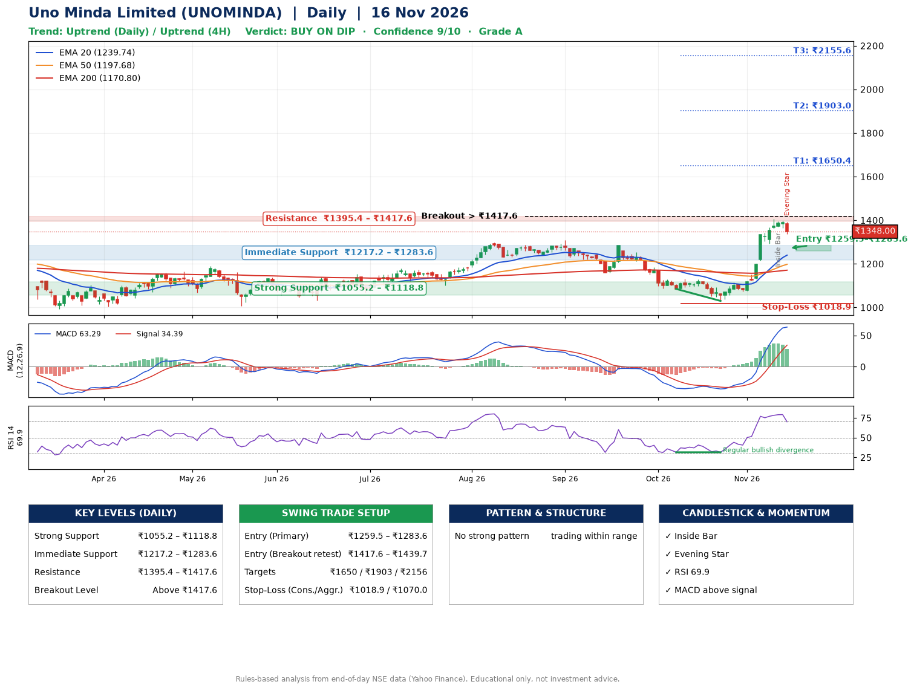

📌 **Uno Minda Limited (UNOMINDA) – Multi-Timeframe Technical Analysis (Daily + 4H Combined)**
_Data up to 16 Nov 2026 · Close ₹1348.00_

**📍 Daily Timeframe Trend**
- Trend: **Uptrend** (price above rising EMAs)
- Recent swing highs: ₹1307.5, ₹1284.0, ₹1130.4 · swing lows: ₹1159.7, ₹1085.0, ₹1030.0
- EMAs: EMA20 ₹1239.7, EMA50 ₹1197.7, EMA200 ₹1170.8; bullish stack (EMA20 > EMA50 > EMA200); price above EMA20, EMA50, EMA200
- MACD 63.29 above signal 34.39 (above zero); histogram falling
- RSI(14) 69.9; Regular bullish divergence

**📍 4-Hour Timeframe Trend**
- Structure: **Uptrend** (price above rising EMAs)
- Pullback/support area: recent 4H swing lows ₹1030.5, ₹1073.0; EMA20 ₹1300.8
- EMA20/50: bullish stack (EMA20 > EMA50); price above EMA20, EMA50
- MACD 64.81 below signal 66.00 (above zero), fresh bearish crossover; histogram falling
- RSI(14) 65.0; no divergence

**📍 Pattern Detection (Both Timeframes)**
- 4H: **Inverse Head & Shoulders** – head ₹1030.5, neckline ₹1129.8
- 4H: **Bull Flag** – 20% pole then a tight 5% flag; trigger above ₹1406.5

**📍 Candlestick Patterns (last 3 daily candles)**
- **Inside Bar** – 12 Nov: compression inside the prior range ₹1361.3–₹1406.5
- **Evening Star** – 16 Nov: three-candle bearish reversal

**📍 Price Action Key Levels (Daily Structure)**

| Zone | Price Level (₹) | Context |
|------|-----------------|---------|
| Strong Support | ₹1055.2 – ₹1118.8 | Cluster of earlier swing lows (demand) |
| Immediate Support | ₹1217.2 – ₹1283.6 | Nearest swing-low / wick area |
| Resistance | ₹1395.4 – ₹1417.6 | Nearest swing-high supply |
| Breakout Level | Above ₹1417.6 | Swing continuation trigger (52-week high ₹1406.5) |

**📍 Swing Trade Setup**

🟢 **Entry Zone**
- Primary: ₹1259.5 – ₹1283.6 (daily support / EMA20 area; enter on a bullish 4H candle)
- Alternate: ₹1417.6 – ₹1439.7 (breakout retest)

🎯 **Profit Targets**
- T1: ₹1650.4
- T2: ₹1903.0
- T3: ₹2155.6

🛑 **Stop-Loss**
- Conservative: below daily swing low (₹1018.9)
- Aggressive: below 4H structure (₹1070.0)
- Risk per share ≈ ₹252.6; reward:risk to T1 ≈ 1.5
- Time to T1: about 43 trading days (it rose this much within 60 trading days 3% of the time in the last 2 years)
- Time to T2: it never rose this much within 60 trading days in the price history

**📌 Strategy Notes**
- Higher timeframe: daily trend is uptrend; only take longs while price holds above ₹1055.2.
- Entry timing: wait for a bullish 4H candle (engulfing/hammer) inside ₹1259.5 – ₹1283.6 rather than buying mid-range.
- EMA stacking: bullish stack (EMA20 > EMA50 > EMA200); price above EMA20, EMA50, EMA200.
- Breakout rule: a daily close above ₹1417.6 with volume above its 20-day average (≈1,223,721) opens T2/T3.
- Momentum: RSI 70 – elevated, prefer dips; Regular bullish divergence.
- Exit discipline: move the stop to entry once T1 is hit; book partial profits at each target.

**STEP 2 — Marked Up Chart**

**✅ Trade Validation Checklist**
- Trend + momentum aligned: Yes · Price at entry zone: No
- Stop defined (₹1018.9) · Reward:risk ≥ 1.5 to T1: No

## 📌 Final Verdict

Recommendation: **🟡 BUY ON DIP**

Confidence: **9/10**

Trade Quality: **A**

Reason:
• Daily uptrend (price above rising EMAs)
• EMAs stacked bullishly

Next Action:
• Wait for a pullback to ₹1259.5–₹1283.6

_Rules-based analysis from end-of-day data. Educational only, not investment advice. Never place orders without your own confirmation._