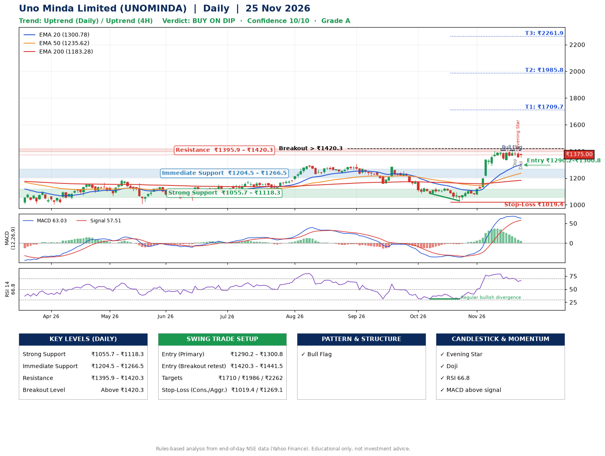

📌 **Uno Minda Limited (UNOMINDA) – Multi-Timeframe Technical Analysis (Daily + 4H Combined)**
_Data up to 25 Nov 2026 · Close ₹1375.00_

**📍 Daily Timeframe Trend**
- Trend: **Uptrend** (price above rising EMAs)
- Recent swing highs: ₹1284.0, ₹1130.4, ₹1406.5 · swing lows: ₹1159.7, ₹1085.0, ₹1030.0
- EMAs: EMA20 ₹1300.8, EMA50 ₹1235.6, EMA200 ₹1183.3; bullish stack (EMA20 > EMA50 > EMA200); price above EMA20, EMA50, EMA200
- MACD 63.03 above signal 57.51 (above zero); histogram falling
- RSI(14) 66.8; Regular bullish divergence

**📍 4-Hour Timeframe Trend**
- Structure: **Uptrend** (higher highs and higher lows)
- Pullback/support area: recent 4H swing lows ₹1073.0, ₹1338.1; EMA20 ₹1353.0
- EMA20/50: bullish stack (EMA20 > EMA50); price above EMA20, EMA50
- MACD 33.74 below signal 44.18 (above zero); histogram rising
- RSI(14) 61.1; Regular bearish divergence

**📍 Pattern Detection (Both Timeframes)**
- Daily: **Bull Flag** – 27% pole then a tight 5% flag; trigger above ₹1409.7
- 4H: **Ascending Triangle** – converging swing highs and lows over the last ~60 sessions
- 4H: **Bull Flag** – 22% pole then a tight 4% flag; trigger above ₹1409.7

**📍 Candlestick Patterns (last 3 daily candles)**
- **Doji** – 20 Nov: indecision; wait for the next candle to confirm direction
- **Evening Star** – 23 Nov: three-candle bearish reversal
- **Doji** – 25 Nov: indecision; wait for the next candle to confirm direction

**📍 Price Action Key Levels (Daily Structure)**

| Zone | Price Level (₹) | Context |
|------|-----------------|---------|
| Strong Support | ₹1055.7 – ₹1118.3 | Cluster of earlier swing lows (demand) |
| Immediate Support | ₹1204.5 – ₹1266.5 | Nearest swing-low / wick area |
| Resistance | ₹1395.9 – ₹1420.3 | Nearest swing-high supply |
| Breakout Level | Above ₹1420.3 | Swing continuation trigger (52-week high ₹1409.7) |

**📍 Swing Trade Setup**

🟢 **Entry Zone**
- Primary: ₹1290.2 – ₹1300.8 (daily support / EMA20 area; enter on a bullish 4H candle)
- Alternate: ₹1420.3 – ₹1441.5 (breakout retest)

🎯 **Profit Targets**
- T1: ₹1709.7
- T2: ₹1985.8
- T3: ₹2261.9

🛑 **Stop-Loss**
- Conservative: below daily swing low (₹1019.4)
- Aggressive: below 4H structure (₹1269.1)
- Risk per share ≈ ₹276.1; reward:risk to T1 ≈ 1.5
- Time to T1: about 40 trading days (it rose this much within 60 trading days 2% of the time in the last 2 years)
- Time to T2: it never rose this much within 60 trading days in the price history

**📌 Strategy Notes**
- Higher timeframe: daily trend is uptrend; only take longs while price holds above ₹1055.7.
- Entry timing: wait for a bullish 4H candle (engulfing/hammer) inside ₹1290.2 – ₹1300.8 rather than buying mid-range.
- EMA stacking: bullish stack (EMA20 > EMA50 > EMA200); price above EMA20, EMA50, EMA200.
- Breakout rule: a daily close above ₹1420.3 with volume above its 20-day average (≈1,459,523) opens T2/T3.
- Momentum: RSI 67 – elevated, prefer dips; Regular bullish divergence.
- Exit discipline: move the stop to entry once T1 is hit; book partial profits at each target.

**STEP 2 — Marked Up Chart**

**✅ Trade Validation Checklist**
- Trend + momentum aligned: Yes · Price at entry zone: No
- Stop defined (₹1019.4) · Reward:risk ≥ 1.5 to T1: Yes

## 📌 Final Verdict

Recommendation: **🟡 BUY ON DIP**

Confidence: **10/10**

Trade Quality: **A**

Reason:
• Daily uptrend (price above rising EMAs)
• EMAs stacked bullishly

Next Action:
• Wait for a pullback to ₹1290.2–₹1300.8

_Rules-based analysis from end-of-day data. Educational only, not investment advice. Never place orders without your own confirmation._