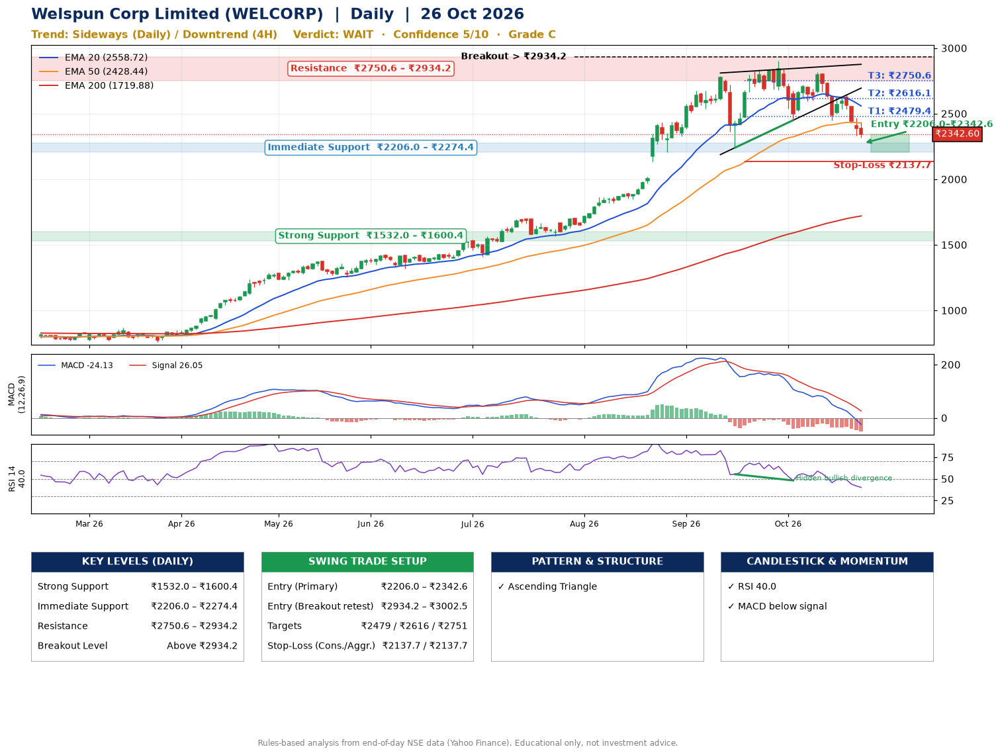

📌 **Welspun Corp Limited (WELCORP) – Multi-Timeframe Technical Analysis (Daily + 4H Combined)**
_Data up to 26 Oct 2026 · Close ₹2342.60_

**📍 Daily Timeframe Trend**
- Trend: **Sideways** (mixed swing structure)
- Recent swing highs: ₹2784.8, ₹2900.0, ₹2818.0 · swing lows: ₹1566.2, ₹2240.2, ₹2450.0
- EMAs: EMA20 ₹2558.7, EMA50 ₹2428.4, EMA200 ₹1719.9; bullish stack (EMA20 > EMA50 > EMA200); price above EMA200
- MACD -24.13 below signal 26.05 (below zero); histogram falling
- RSI(14) 40.0; Hidden bullish divergence

**📍 4-Hour Timeframe Trend**
- Structure: **Downtrend** (lower highs and lower lows)
- Pullback/support area: recent 4H swing lows ₹2594.3, ₹2450.7; EMA20 ₹2516.2
- EMA20/50: bearish stack (EMA20 < EMA50); price below all EMAs
- MACD -73.18 below signal -48.51 (below zero); histogram falling
- RSI(14) 33.8; no divergence

**📍 Pattern Detection (Both Timeframes)**
- Daily: **Ascending Triangle** – converging swing highs and lows over the last ~60 sessions
- 4H: **Head & Shoulders** – head ₹2818.0, neckline ₹2450.7
- 4H: **Descending Triangle** – converging swing highs and lows over the last ~60 sessions

**📍 Candlestick Patterns (last 3 daily candles)**
- No notable candlestick signal in the last 3 sessions.

**📍 Price Action Key Levels (Daily Structure)**

| Zone | Price Level (₹) | Context |
|------|-----------------|---------|
| Strong Support | ₹1532.0 – ₹1600.4 | Cluster of earlier swing lows (demand) |
| Immediate Support | ₹2206.0 – ₹2274.4 | Nearest swing-low / wick area |
| Resistance | ₹2750.6 – ₹2934.2 | Nearest swing-high supply |
| Breakout Level | Above ₹2934.2 | Swing continuation trigger (52-week high ₹2900.0) |

**📍 Swing Trade Setup**

🟢 **Entry Zone**
- Primary: ₹2206.0 – ₹2342.6 (daily support / EMA20 area; enter on a bullish 4H candle)
- Alternate: ₹2934.2 – ₹3002.5 (breakout retest)

🎯 **Profit Targets**
- T1: ₹2479.4
- T2: ₹2616.1
- T3: ₹2750.6

🛑 **Stop-Loss**
- Conservative: below daily swing low (₹2137.7)
- Aggressive: below 4H structure (₹2137.7)
- Risk per share ≈ ₹136.7; reward:risk to T1 ≈ 1.5

**📌 Strategy Notes**
- Higher timeframe: daily trend is sideways; only take longs while price holds above ₹1532.0.
- Entry timing: wait for a bullish 4H candle (engulfing/hammer) inside ₹2206.0 – ₹2342.6 rather than buying mid-range.
- EMA stacking: bullish stack (EMA20 > EMA50 > EMA200); price above EMA200.
- Breakout rule: a daily close above ₹2934.2 with volume above its 20-day average (≈1,592,090) opens T2/T3.
- Momentum: RSI 40 – room to run; Hidden bullish divergence.
- Exit discipline: move the stop to entry once T1 is hit; book partial profits at each target.

**STEP 2 — Marked Up Chart**

**✅ Trade Validation Checklist**
- Trend + momentum aligned: No · Price at entry zone: Yes
- Stop defined (₹2137.7) · Reward:risk ≥ 1.5 to T1: Yes

## 📌 Final Verdict

Recommendation: **🟠 WAIT**

Confidence: **5/10**

Trade Quality: **C**

Reason:
• Sharp pullback: 17% below the recent ₹2818.0 high
• EMAs stacked bullishly

Next Action:
• Wait for a breakout above ₹2934.2

_Rules-based analysis from end-of-day data. Educational only, not investment advice. Never place orders without your own confirmation._