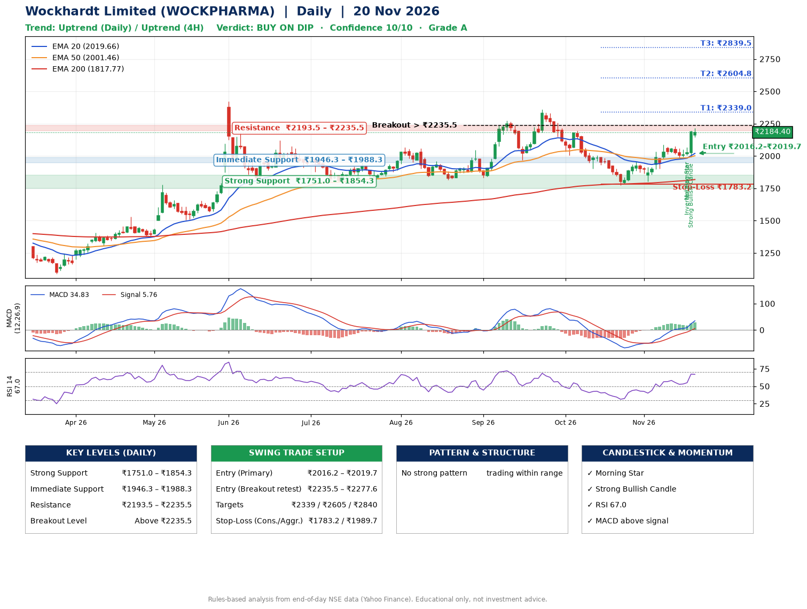

📌 **Wockhardt Limited (WOCKPHARMA) – Multi-Timeframe Technical Analysis (Daily + 4H Combined)**
_Data up to 20 Nov 2026 · Close ₹2184.40_

**📍 Daily Timeframe Trend**
- Trend: **Uptrend** (price above rising EMAs)
- Recent swing highs: ₹2272.9, ₹2360.0, ₹2089.0 · swing lows: ₹1967.3, ₹1772.0, ₹1804.2
- EMAs: EMA20 ₹2019.7, EMA50 ₹2001.5, EMA200 ₹1817.8; bullish stack (EMA20 > EMA50 > EMA200); price above EMA20, EMA50, EMA200
- MACD 34.83 above signal 5.76 (above zero); histogram rising
- RSI(14) 67.0; no divergence on the last two swings

**📍 4-Hour Timeframe Trend**
- Structure: **Uptrend** (price above rising EMAs)
- Pullback/support area: recent 4H swing lows ₹1984.0, ₹1995.1; EMA20 ₹2055.5
- EMA20/50: bullish stack (EMA20 > EMA50); price above EMA20, EMA50
- MACD 53.13 above signal 36.79 (above zero), fresh bullish crossover; histogram rising
- RSI(14) 73.1; no divergence

**📍 Pattern Detection (Both Timeframes)**
- No strong pattern detected. Trading within range.

**📍 Candlestick Patterns (last 3 daily candles)**
- **Inverted Hammer** – 18 Nov: long upper wick shows selling near ₹2065.0
- **Morning Star** – 18 Nov: three-candle bullish reversal
- **Strong Bullish Candle** – 19 Nov: wide-range green candle, buyers in control

**📍 Price Action Key Levels (Daily Structure)**

| Zone | Price Level (₹) | Context |
|------|-----------------|---------|
| Strong Support | ₹1751.0 – ₹1854.3 | Cluster of earlier swing lows (demand) |
| Immediate Support | ₹1946.3 – ₹1988.3 | Nearest swing-low / wick area |
| Resistance | ₹2193.5 – ₹2235.5 | Nearest swing-high supply |
| Breakout Level | Above ₹2235.5 | Swing continuation trigger (52-week high ₹2422.3) |

**📍 Swing Trade Setup**

🟢 **Entry Zone**
- Primary: ₹2016.2 – ₹2019.7 (daily support / EMA20 area; enter on a bullish 4H candle)
- Alternate: ₹2235.5 – ₹2277.6 (breakout retest)

🎯 **Profit Targets**
- T1: ₹2339.0
- T2: ₹2604.8
- T3: ₹2839.5

🛑 **Stop-Loss**
- Conservative: below daily swing low (₹1783.2)
- Aggressive: below 4H structure (₹1989.7)
- Risk per share ≈ ₹234.7; reward:risk to T1 ≈ 1.4
- Time to T1: about 16 trading days (it rose this much within 60 trading days 58% of the time in the last 2 years)
- Time to T2: about 23 trading days (it rose this much within 60 trading days 28% of the time in the last 2 years)

**📌 Strategy Notes**
- Higher timeframe: daily trend is uptrend; only take longs while price holds above ₹1751.0.
- Entry timing: wait for a bullish 4H candle (engulfing/hammer) inside ₹2016.2 – ₹2019.7 rather than buying mid-range.
- EMA stacking: bullish stack (EMA20 > EMA50 > EMA200); price above EMA20, EMA50, EMA200.
- Breakout rule: a daily close above ₹2235.5 with volume above its 20-day average (≈763,438) opens T2/T3.
- Momentum: RSI 67 – elevated, prefer dips; no divergence on the last two swings.
- Exit discipline: move the stop to entry once T1 is hit; book partial profits at each target.

**STEP 2 — Marked Up Chart**

**✅ Trade Validation Checklist**
- Trend + momentum aligned: Yes · Price at entry zone: No
- Stop defined (₹1783.2) · Reward:risk ≥ 1.5 to T1: No

## 📌 Final Verdict

Recommendation: **🟡 BUY ON DIP**

Confidence: **10/10**

Trade Quality: **A**

Reason:
• Daily uptrend (price above rising EMAs)
• EMAs stacked bullishly

Next Action:
• Wait for a pullback to ₹2016.2–₹2019.7

_Rules-based analysis from end-of-day data. Educational only, not investment advice. Never place orders without your own confirmation._