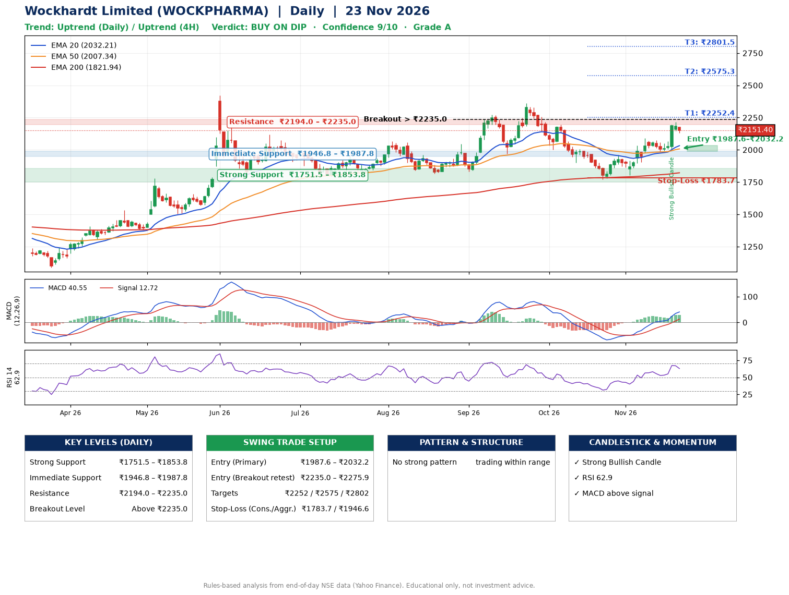

📌 **Wockhardt Limited (WOCKPHARMA) – Multi-Timeframe Technical Analysis (Daily + 4H Combined)**
_Data up to 23 Nov 2026 · Close ₹2151.40_

**📍 Daily Timeframe Trend**
- Trend: **Uptrend** (price above rising EMAs)
- Recent swing highs: ₹2272.9, ₹2360.0, ₹2089.0 · swing lows: ₹1967.3, ₹1772.0, ₹1804.2
- EMAs: EMA20 ₹2032.2, EMA50 ₹2007.3, EMA200 ₹1821.9; bullish stack (EMA20 > EMA50 > EMA200); price above EMA20, EMA50, EMA200
- MACD 40.55 above signal 12.72 (above zero); histogram falling
- RSI(14) 62.9; no divergence on the last two swings

**📍 4-Hour Timeframe Trend**
- Structure: **Uptrend** (higher highs and higher lows)
- Pullback/support area: recent 4H swing lows ₹1984.0, ₹1995.1; EMA20 ₹2071.9
- EMA20/50: bullish stack (EMA20 > EMA50); price above EMA20, EMA50
- MACD 53.31 above signal 42.69 (above zero); histogram falling
- RSI(14) 66.2; no divergence

**📍 Pattern Detection (Both Timeframes)**
- No strong pattern detected. Trading within range.

**📍 Candlestick Patterns (last 3 daily candles)**
- **Strong Bullish Candle** – 19 Nov: wide-range green candle, buyers in control

**📍 Price Action Key Levels (Daily Structure)**

| Zone | Price Level (₹) | Context |
|------|-----------------|---------|
| Strong Support | ₹1751.5 – ₹1853.8 | Cluster of earlier swing lows (demand) |
| Immediate Support | ₹1946.8 – ₹1987.8 | Nearest swing-low / wick area |
| Resistance | ₹2194.0 – ₹2235.0 | Nearest swing-high supply |
| Breakout Level | Above ₹2235.0 | Swing continuation trigger (52-week high ₹2422.3) |

**📍 Swing Trade Setup**

🟢 **Entry Zone**
- Primary: ₹1987.6 – ₹2032.2 (daily support / EMA20 area; enter on a bullish 4H candle)
- Alternate: ₹2235.0 – ₹2275.9 (breakout retest)

🎯 **Profit Targets**
- T1: ₹2252.4
- T2: ₹2575.3
- T3: ₹2801.5

🛑 **Stop-Loss**
- Conservative: below daily swing low (₹1783.7)
- Aggressive: below 4H structure (₹1946.6)
- Risk per share ≈ ₹226.2; reward:risk to T1 ≈ 1.1
- Time to T1: about 17 trading days (it rose this much within 60 trading days 70% of the time in the last 2 years)
- Time to T2: about 23 trading days (it rose this much within 60 trading days 29% of the time in the last 2 years)

**📌 Strategy Notes**
- Higher timeframe: daily trend is uptrend; only take longs while price holds above ₹1751.5.
- Entry timing: wait for a bullish 4H candle (engulfing/hammer) inside ₹1987.6 – ₹2032.2 rather than buying mid-range.
- EMA stacking: bullish stack (EMA20 > EMA50 > EMA200); price above EMA20, EMA50, EMA200.
- Breakout rule: a daily close above ₹2235.0 with volume above its 20-day average (≈735,146) opens T2/T3.
- Momentum: RSI 63 – room to run; no divergence on the last two swings.
- Exit discipline: move the stop to entry once T1 is hit; book partial profits at each target.

**STEP 2 — Marked Up Chart**

**✅ Trade Validation Checklist**
- Trend + momentum aligned: Yes · Price at entry zone: No
- Stop defined (₹1783.7) · Reward:risk ≥ 1.5 to T1: No

## 📌 Final Verdict

Recommendation: **🟡 BUY ON DIP**

Confidence: **9/10**

Trade Quality: **A**

Reason:
• Daily uptrend (price above rising EMAs)
• EMAs stacked bullishly

Next Action:
• Wait for a pullback to ₹1987.6–₹2032.2

_Rules-based analysis from end-of-day data. Educational only, not investment advice. Never place orders without your own confirmation._