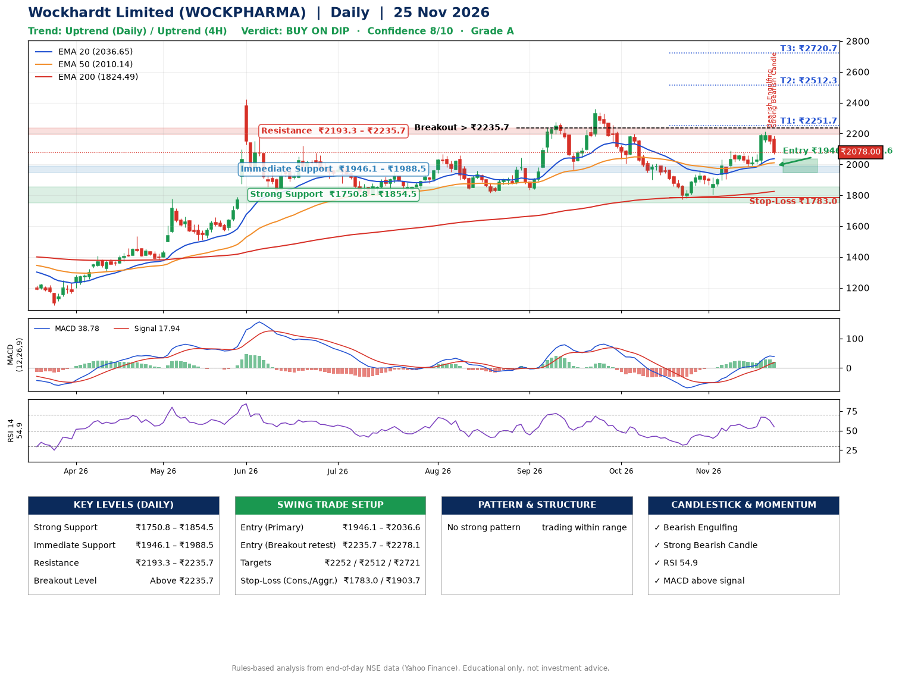

📌 **Wockhardt Limited (WOCKPHARMA) – Multi-Timeframe Technical Analysis (Daily + 4H Combined)**
_Data up to 25 Nov 2026 · Close ₹2078.00_

**📍 Daily Timeframe Trend**
- Trend: **Uptrend** (price above rising EMAs)
- Recent swing highs: ₹2272.9, ₹2360.0, ₹2089.0 · swing lows: ₹1967.3, ₹1772.0, ₹1804.2
- EMAs: EMA20 ₹2036.6, EMA50 ₹2010.1, EMA200 ₹1824.5; bullish stack (EMA20 > EMA50 > EMA200); price above EMA20, EMA50, EMA200
- MACD 38.78 above signal 17.94 (above zero); histogram falling
- RSI(14) 54.9; no divergence on the last two swings

**📍 4-Hour Timeframe Trend**
- Structure: **Uptrend** (higher highs and higher lows)
- Pullback/support area: recent 4H swing lows ₹1984.0, ₹1995.1; EMA20 ₹2074.9
- EMA20/50: bullish stack (EMA20 > EMA50); price above EMA20, EMA50
- MACD 43.04 below signal 43.71 (above zero), fresh bearish crossover; histogram falling
- RSI(14) 53.6; no divergence

**📍 Pattern Detection (Both Timeframes)**
- No strong pattern detected. Trading within range.

**📍 Candlestick Patterns (last 3 daily candles)**
- **Bearish Engulfing** – 23 Nov: sellers fully reversed the prior green candle
- **Strong Bearish Candle** – 25 Nov: wide-range red candle, sellers in control

**📍 Price Action Key Levels (Daily Structure)**

| Zone | Price Level (₹) | Context |
|------|-----------------|---------|
| Strong Support | ₹1750.8 – ₹1854.5 | Cluster of earlier swing lows (demand) |
| Immediate Support | ₹1946.1 – ₹1988.5 | Nearest swing-low / wick area |
| Resistance | ₹2193.3 – ₹2235.7 | Nearest swing-high supply |
| Breakout Level | Above ₹2235.7 | Swing continuation trigger (52-week high ₹2422.3) |

**📍 Swing Trade Setup**

🟢 **Entry Zone**
- Primary: ₹1946.1 – ₹2036.6 (daily support / EMA20 area; enter on a bullish 4H candle)
- Alternate: ₹2235.7 – ₹2278.1 (breakout retest)

🎯 **Profit Targets**
- T1: ₹2251.7
- T2: ₹2512.3
- T3: ₹2720.7

🛑 **Stop-Loss**
- Conservative: below daily swing low (₹1783.0)
- Aggressive: below 4H structure (₹1903.7)
- Risk per share ≈ ₹208.4; reward:risk to T1 ≈ 1.2
- Time to T1: about 17 trading days (it rose this much within 60 trading days 66% of the time in the last 2 years)
- Time to T2: about 24 trading days (it rose this much within 60 trading days 35% of the time in the last 2 years)

**📌 Strategy Notes**
- Higher timeframe: daily trend is uptrend; only take longs while price holds above ₹1750.8.
- Entry timing: wait for a bullish 4H candle (engulfing/hammer) inside ₹1946.1 – ₹2036.6 rather than buying mid-range.
- EMA stacking: bullish stack (EMA20 > EMA50 > EMA200); price above EMA20, EMA50, EMA200.
- Breakout rule: a daily close above ₹2235.7 with volume above its 20-day average (≈748,548) opens T2/T3.
- Momentum: RSI 55 – room to run; no divergence on the last two swings.
- Exit discipline: move the stop to entry once T1 is hit; book partial profits at each target.

**STEP 2 — Marked Up Chart**

**✅ Trade Validation Checklist**
- Trend + momentum aligned: Yes · Price at entry zone: No
- Stop defined (₹1783.0) · Reward:risk ≥ 1.5 to T1: No

## 📌 Final Verdict

Recommendation: **🟡 BUY ON DIP**

Confidence: **8/10**

Trade Quality: **A**

Reason:
• Daily uptrend (price above rising EMAs)
• EMAs stacked bullishly

Next Action:
• Wait for a pullback to ₹1946.1–₹2036.6, or a breakout above ₹2235.7

_Rules-based analysis from end-of-day data. Educational only, not investment advice. Never place orders without your own confirmation._