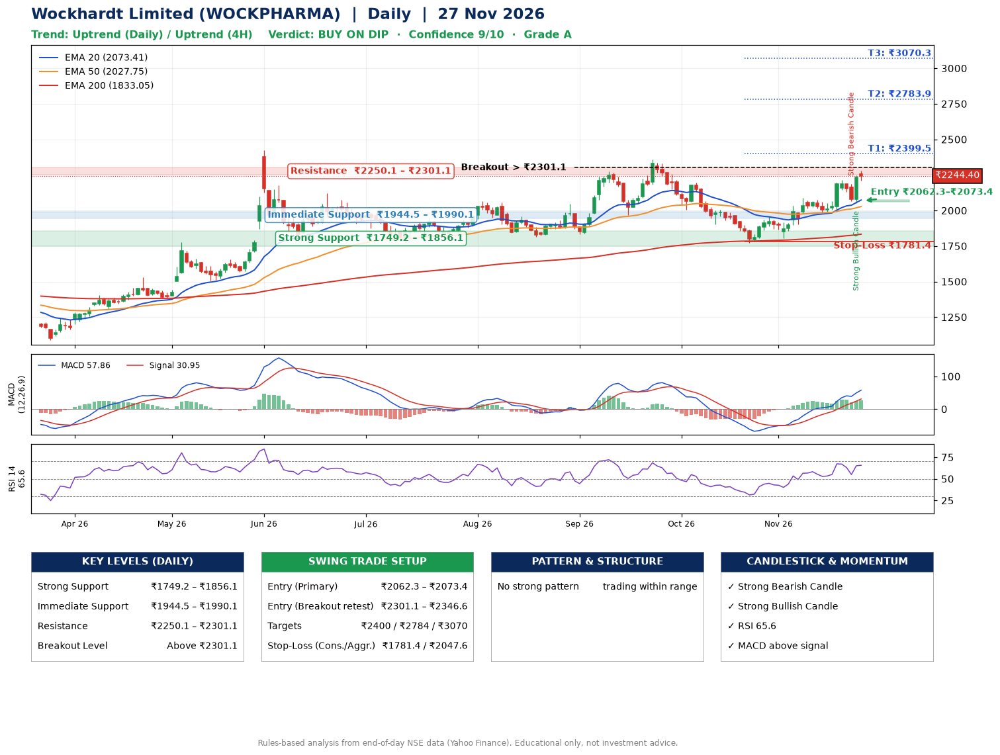

📌 **Wockhardt Limited (WOCKPHARMA) – Multi-Timeframe Technical Analysis (Daily + 4H Combined)**
_Data up to 27 Nov 2026 · Close ₹2244.40_

**📍 Daily Timeframe Trend**
- Trend: **Uptrend** (price above rising EMAs)
- Recent swing highs: ₹2272.9, ₹2360.0, ₹2089.0 · swing lows: ₹1967.3, ₹1772.0, ₹1804.2
- EMAs: EMA20 ₹2073.4, EMA50 ₹2027.8, EMA200 ₹1833.0; bullish stack (EMA20 > EMA50 > EMA200); price above EMA20, EMA50, EMA200
- MACD 57.86 above signal 30.95 (above zero); histogram rising
- RSI(14) 65.6; no divergence on the last two swings

**📍 4-Hour Timeframe Trend**
- Structure: **Uptrend** (higher highs and higher lows)
- Pullback/support area: recent 4H swing lows ₹1995.1, ₹2053.6; EMA20 ₹2124.9
- EMA20/50: bullish stack (EMA20 > EMA50); price above EMA20, EMA50
- MACD 60.31 above signal 50.49 (above zero), fresh bullish crossover; histogram rising
- RSI(14) 69.4; Hidden bullish divergence

**📍 Pattern Detection (Both Timeframes)**
- No strong pattern detected. Trading within range.

**📍 Candlestick Patterns (last 3 daily candles)**
- **Strong Bearish Candle** – 25 Nov: wide-range red candle, sellers in control
- **Strong Bullish Candle** – 26 Nov: wide-range green candle, buyers in control

**📍 Price Action Key Levels (Daily Structure)**

| Zone | Price Level (₹) | Context |
|------|-----------------|---------|
| Strong Support | ₹1749.2 – ₹1856.1 | Cluster of earlier swing lows (demand) |
| Immediate Support | ₹1944.5 – ₹1990.1 | Nearest swing-low / wick area |
| Resistance | ₹2250.1 – ₹2301.1 | Nearest swing-high supply |
| Breakout Level | Above ₹2301.1 | Swing continuation trigger (52-week high ₹2422.3) |

**📍 Swing Trade Setup**

🟢 **Entry Zone**
- Primary: ₹2062.3 – ₹2073.4 (daily support / EMA20 area; enter on a bullish 4H candle)
- Alternate: ₹2301.1 – ₹2346.6 (breakout retest)

🎯 **Profit Targets**
- T1: ₹2399.5
- T2: ₹2783.9
- T3: ₹3070.3

🛑 **Stop-Loss**
- Conservative: below daily swing low (₹1781.4)
- Aggressive: below 4H structure (₹2047.6)
- Risk per share ≈ ₹286.4; reward:risk to T1 ≈ 1.2
- Time to T1: about 17 trading days (it rose this much within 60 trading days 58% of the time in the last 2 years)
- Time to T2: about 24 trading days (it rose this much within 60 trading days 21% of the time in the last 2 years)

**📌 Strategy Notes**
- Higher timeframe: daily trend is uptrend; only take longs while price holds above ₹1749.2.
- Entry timing: wait for a bullish 4H candle (engulfing/hammer) inside ₹2062.3 – ₹2073.4 rather than buying mid-range.
- EMA stacking: bullish stack (EMA20 > EMA50 > EMA200); price above EMA20, EMA50, EMA200.
- Breakout rule: a daily close above ₹2301.1 with volume above its 20-day average (≈808,303) opens T2/T3.
- Momentum: RSI 66 – elevated, prefer dips; no divergence on the last two swings.
- Exit discipline: move the stop to entry once T1 is hit; book partial profits at each target.

**STEP 2 — Marked Up Chart**

**✅ Trade Validation Checklist**
- Trend + momentum aligned: Yes · Price at entry zone: No
- Stop defined (₹1781.4) · Reward:risk ≥ 1.5 to T1: No

## 📌 Final Verdict

Recommendation: **🟡 BUY ON DIP**

Confidence: **9/10**

Trade Quality: **A**

Reason:
• Daily uptrend (price above rising EMAs)
• EMAs stacked bullishly

Next Action:
• Wait for a pullback to ₹2062.3–₹2073.4

_Rules-based analysis from end-of-day data. Educational only, not investment advice. Never place orders without your own confirmation._