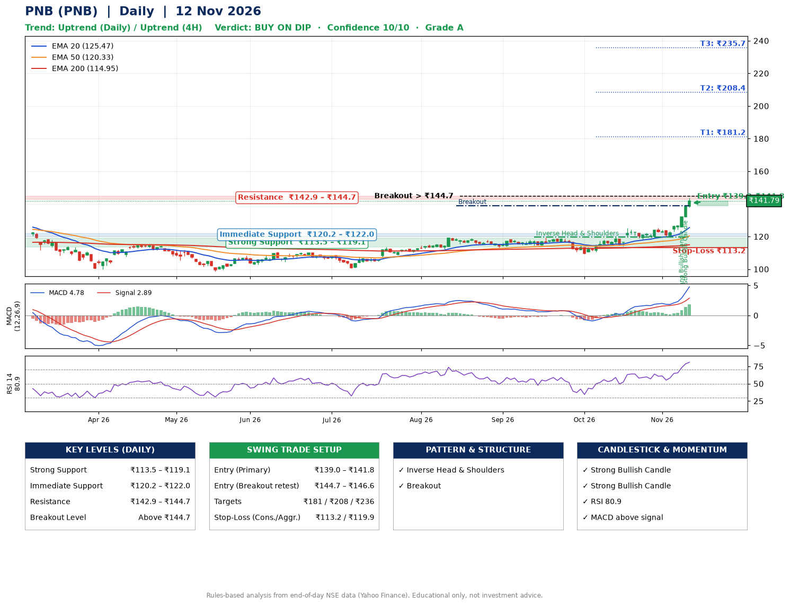

📌 **PNB (PNB) – Multi-Timeframe Technical Analysis (Daily + 4H Combined)**
_Data up to 12 Nov 2026 · Close ₹141.79_

**📍 Daily Timeframe Trend**
- Trend: **Uptrend** (higher highs and higher lows)
- Recent swing highs: ₹118.2, ₹119.4, ₹125.2 · swing lows: ₹114.5, ₹109.4, ₹114.1
- EMAs: EMA20 ₹125.5, EMA50 ₹120.3, EMA200 ₹114.9; bullish stack (EMA20 > EMA50 > EMA200); price above EMA20, EMA50, EMA200
- MACD 4.78 above signal 2.89 (above zero); histogram rising
- RSI(14) 80.9; no divergence on the last two swings

**📍 4-Hour Timeframe Trend**
- Structure: **Uptrend** (higher highs and higher lows)
- Pullback/support area: recent 4H swing lows ₹118.2, ₹120.2; EMA20 ₹129.6
- EMA20/50: bullish stack (EMA20 > EMA50); price above EMA20, EMA50
- MACD 5.05 above signal 3.25 (above zero); histogram rising
- RSI(14) 82.8; Hidden bullish divergence

**📍 Pattern Detection (Both Timeframes)**
- Daily: **Inverse Head & Shoulders** – head ₹109.4, neckline ₹119.6
- Daily: **Breakout** – closed above the 60-session high ₹139.0 on strong volume
- 4H: **Double Bottom** – bottoms near ₹118.2/₹120.2, neckline ₹125.1, confirmed (closed above neckline)
- 4H: **Ascending Triangle** – converging swing highs and lows over the last ~60 sessions

**📍 Candlestick Patterns (last 3 daily candles)**
- **Strong Bullish Candle** – 09 Nov: wide-range green candle, buyers in control
- **Strong Bullish Candle** – 11 Nov: wide-range green candle, buyers in control

**📍 Price Action Key Levels (Daily Structure)**

| Zone | Price Level (₹) | Context |
|------|-----------------|---------|
| Strong Support | ₹113.5 – ₹119.1 | Cluster of earlier swing lows (demand) |
| Immediate Support | ₹120.2 – ₹122.0 | Nearest swing-low / wick area |
| Resistance | ₹142.9 – ₹144.7 | Nearest swing-high supply |
| Breakout Level | Above ₹144.7 | Swing continuation trigger (52-week high ₹143.8) |

**📍 Swing Trade Setup**

🟢 **Entry Zone**
- Primary: ₹139.0 – ₹141.8 (daily support / EMA20 area; enter on a bullish 4H candle)
- Alternate: ₹144.7 – ₹146.6 (breakout retest)

🎯 **Profit Targets**
- T1: ₹181.2
- T2: ₹208.4
- T3: ₹235.7

🛑 **Stop-Loss**
- Conservative: below daily swing low (₹113.2)
- Aggressive: below 4H structure (₹119.9)
- Risk per share ≈ ₹27.2; reward:risk to T1 ≈ 1.5
- Time to T1: about 56 trading days (it rose this much within 60 trading days 0% of the time in the last 2 years)
- Time to T2: it never rose this much within 60 trading days in the price history

**📌 Strategy Notes**
- Higher timeframe: daily trend is uptrend; only take longs while price holds above ₹113.5.
- Entry timing: wait for a bullish 4H candle (engulfing/hammer) inside ₹139.0 – ₹141.8 rather than buying mid-range.
- EMA stacking: bullish stack (EMA20 > EMA50 > EMA200); price above EMA20, EMA50, EMA200.
- Breakout rule: a daily close above ₹144.7 with volume above its 20-day average (≈30,371,938) opens T2/T3.
- Momentum: RSI 81 – elevated, prefer dips; no divergence on the last two swings.
- Exit discipline: move the stop to entry once T1 is hit; book partial profits at each target.

**STEP 2 — Marked Up Chart**

**✅ Trade Validation Checklist**
- Trend + momentum aligned: Yes · Price at entry zone: Yes
- Stop defined (₹113.2) · Reward:risk ≥ 1.5 to T1: No

## 📌 Final Verdict

Recommendation: **🟡 BUY ON DIP**

Confidence: **10/10**

Trade Quality: **A**

Reason:
• Daily uptrend (higher highs and higher lows)
• EMAs stacked bullishly

Next Action:
• Wait for a pullback to ₹139.0–₹141.8, or a breakout above ₹144.7

_Rules-based analysis from end-of-day data. Educational only, not investment advice. Never place orders without your own confirmation._