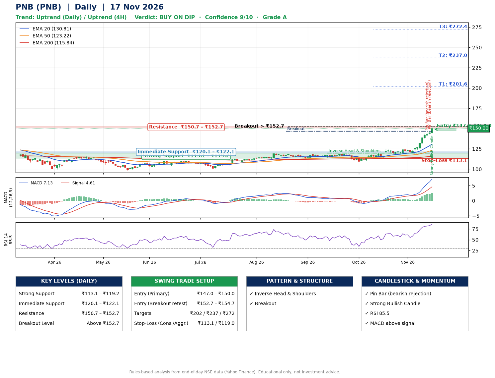

📌 **PNB (PNB) – Multi-Timeframe Technical Analysis (Daily + 4H Combined)**
_Data up to 17 Nov 2026 · Close ₹150.00_

**📍 Daily Timeframe Trend**
- Trend: **Uptrend** (higher highs and higher lows)
- Recent swing highs: ₹118.2, ₹119.4, ₹125.2 · swing lows: ₹114.5, ₹109.4, ₹114.1
- EMAs: EMA20 ₹130.8, EMA50 ₹123.2, EMA200 ₹115.8; bullish stack (EMA20 > EMA50 > EMA200); price above EMA20, EMA50, EMA200
- MACD 7.13 above signal 4.61 (above zero); histogram rising
- RSI(14) 85.5; no divergence on the last two swings

**📍 4-Hour Timeframe Trend**
- Structure: **Uptrend** (higher highs and higher lows)
- Pullback/support area: recent 4H swing lows ₹118.2, ₹120.2; EMA20 ₹139.4
- EMA20/50: bullish stack (EMA20 > EMA50); price above EMA20, EMA50
- MACD 7.08 above signal 6.09 (above zero); histogram falling
- RSI(14) 81.5; Hidden bullish divergence

**📍 Pattern Detection (Both Timeframes)**
- Daily: **Inverse Head & Shoulders** – head ₹109.4, neckline ₹119.6
- Daily: **Breakout** – closed above the 60-session high ₹146.9 on strong volume
- 4H: **Double Bottom** – bottoms near ₹118.2/₹120.2, neckline ₹125.1, confirmed (closed above neckline)
- 4H: **Ascending Triangle** – converging swing highs and lows over the last ~60 sessions
- 4H: **Bull Flag** – 16% pole then a tight 8% flag; trigger above ₹152.6

**📍 Candlestick Patterns (last 3 daily candles)**
- **Pin Bar (bearish rejection)** – 13 Nov: long upper wick shows selling near ₹145.1
- **Pin Bar (bearish rejection)** – 16 Nov: long upper wick shows selling near ₹146.9
- **Strong Bullish Candle** – 17 Nov: wide-range green candle, buyers in control

**📍 Price Action Key Levels (Daily Structure)**

| Zone | Price Level (₹) | Context |
|------|-----------------|---------|
| Strong Support | ₹113.1 – ₹119.2 | Cluster of earlier swing lows (demand) |
| Immediate Support | ₹120.1 – ₹122.1 | Nearest swing-low / wick area |
| Resistance | ₹150.7 – ₹152.7 | Nearest swing-high supply |
| Breakout Level | Above ₹152.7 | Swing continuation trigger (52-week high ₹151.7) |

**📍 Swing Trade Setup**

🟢 **Entry Zone**
- Primary: ₹147.0 – ₹150.0 (daily support / EMA20 area; enter on a bullish 4H candle)
- Alternate: ₹152.7 – ₹154.7 (breakout retest)

🎯 **Profit Targets**
- T1: ₹201.6
- T2: ₹237.0
- T3: ₹272.4

🛑 **Stop-Loss**
- Conservative: below daily swing low (₹113.1)
- Aggressive: below 4H structure (₹119.9)
- Risk per share ≈ ₹35.4; reward:risk to T1 ≈ 1.5
- Time to T1: it never rose this much within 60 trading days in the price history
- Time to T2: it never rose this much within 60 trading days in the price history

**📌 Strategy Notes**
- Higher timeframe: daily trend is uptrend; only take longs while price holds above ₹113.1.
- Entry timing: wait for a bullish 4H candle (engulfing/hammer) inside ₹147.0 – ₹150.0 rather than buying mid-range.
- EMA stacking: bullish stack (EMA20 > EMA50 > EMA200); price above EMA20, EMA50, EMA200.
- Breakout rule: a daily close above ₹152.7 with volume above its 20-day average (≈36,028,926) opens T2/T3.
- Momentum: RSI 85 – elevated, prefer dips; no divergence on the last two swings.
- Exit discipline: move the stop to entry once T1 is hit; book partial profits at each target.

**STEP 2 — Marked Up Chart**

**✅ Trade Validation Checklist**
- Trend + momentum aligned: Yes · Price at entry zone: Yes
- Stop defined (₹113.1) · Reward:risk ≥ 1.5 to T1: Yes

## 📌 Final Verdict

Recommendation: **🟡 BUY ON DIP**

Confidence: **9/10**

Trade Quality: **A**

Reason:
• Daily uptrend (higher highs and higher lows)
• EMAs stacked bullishly

Next Action:
• Wait for a pullback to ₹147.0–₹150.0, or a breakout above ₹152.7

_Rules-based analysis from end-of-day data. Educational only, not investment advice. Never place orders without your own confirmation._