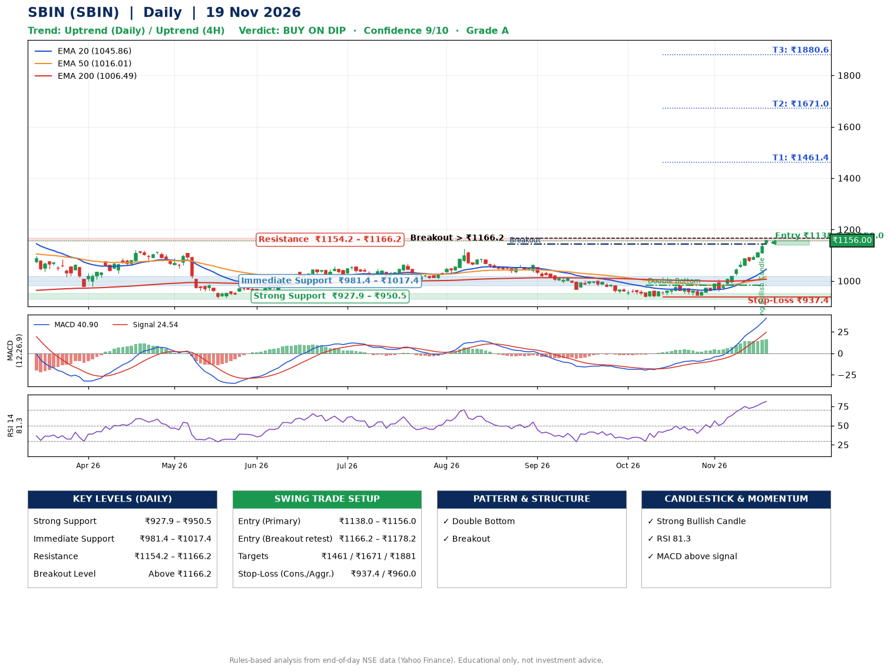

📌 **SBIN (SBIN) – Multi-Timeframe Technical Analysis (Daily + 4H Combined)**
_Data up to 19 Nov 2026 · Close ₹1156.00_

**📍 Daily Timeframe Trend**
- Trend: **Uptrend** (price above rising EMAs)
- Recent swing highs: ₹1124.5, ₹1062.3, ₹983.8 · swing lows: ₹968.0, ₹937.5, ₹943.4
- EMAs: EMA20 ₹1045.9, EMA50 ₹1016.0, EMA200 ₹1006.5; bullish stack (EMA20 > EMA50 > EMA200); price above EMA20, EMA50, EMA200
- MACD 40.90 above signal 24.54 (above zero); histogram rising
- RSI(14) 81.3; no divergence on the last two swings

**📍 4-Hour Timeframe Trend**
- Structure: **Uptrend** (higher highs and higher lows)
- Pullback/support area: recent 4H swing lows ₹944.7, ₹961.5; EMA20 ₹1081.8
- EMA20/50: bullish stack (EMA20 > EMA50); price above EMA20, EMA50
- MACD 39.53 above signal 33.83 (above zero); histogram rising
- RSI(14) 86.0; no divergence

**📍 Pattern Detection (Both Timeframes)**
- Daily: **Double Bottom** – bottoms near ₹937.5/₹943.4, neckline ₹983.8, confirmed (closed above neckline)
- Daily: **Breakout** – closed above the 60-session high ₹1142.7 on strong volume

**📍 Candlestick Patterns (last 3 daily candles)**
- **Strong Bullish Candle** – 18 Nov: wide-range green candle, buyers in control

**📍 Price Action Key Levels (Daily Structure)**

| Zone | Price Level (₹) | Context |
|------|-----------------|---------|
| Strong Support | ₹927.9 – ₹950.5 | Cluster of earlier swing lows (demand) |
| Immediate Support | ₹981.4 – ₹1017.4 | Nearest swing-low / wick area |
| Resistance | ₹1154.2 – ₹1166.2 | Nearest swing-high supply |
| Breakout Level | Above ₹1166.2 | Swing continuation trigger (52-week high ₹1234.7) |

**📍 Swing Trade Setup**

🟢 **Entry Zone**
- Primary: ₹1138.0 – ₹1156.0 (daily support / EMA20 area; enter on a bullish 4H candle)
- Alternate: ₹1166.2 – ₹1178.2 (breakout retest)

🎯 **Profit Targets**
- T1: ₹1461.4
- T2: ₹1671.0
- T3: ₹1880.6

🛑 **Stop-Loss**
- Conservative: below daily swing low (₹937.4)
- Aggressive: below 4H structure (₹960.0)
- Risk per share ≈ ₹209.6; reward:risk to T1 ≈ 1.5
- Time to T1: about 49 trading days (it rose this much within 60 trading days 3% of the time in the last 2 years)
- Time to T2: it never rose this much within 60 trading days in the price history

**📌 Strategy Notes**
- Higher timeframe: daily trend is uptrend; only take longs while price holds above ₹927.9.
- Entry timing: wait for a bullish 4H candle (engulfing/hammer) inside ₹1138.0 – ₹1156.0 rather than buying mid-range.
- EMA stacking: bullish stack (EMA20 > EMA50 > EMA200); price above EMA20, EMA50, EMA200.
- Breakout rule: a daily close above ₹1166.2 with volume above its 20-day average (≈16,979,252) opens T2/T3.
- Momentum: RSI 81 – elevated, prefer dips; no divergence on the last two swings.
- Exit discipline: move the stop to entry once T1 is hit; book partial profits at each target.

**STEP 2 — Marked Up Chart**

**✅ Trade Validation Checklist**
- Trend + momentum aligned: Yes · Price at entry zone: Yes
- Stop defined (₹937.4) · Reward:risk ≥ 1.5 to T1: Yes

## 📌 Final Verdict

Recommendation: **🟡 BUY ON DIP**

Confidence: **9/10**

Trade Quality: **A**

Reason:
• Daily uptrend (price above rising EMAs)
• EMAs stacked bullishly

Next Action:
• Wait for a pullback to ₹1138.0–₹1156.0, or a breakout above ₹1166.2

_Rules-based analysis from end-of-day data. Educational only, not investment advice. Never place orders without your own confirmation._