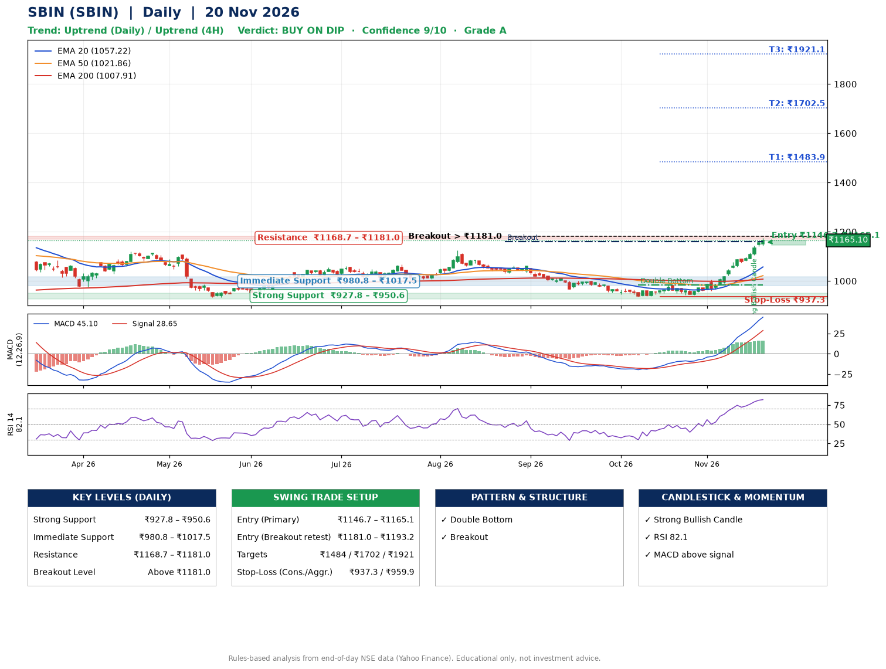

📌 **SBIN (SBIN) – Multi-Timeframe Technical Analysis (Daily + 4H Combined)**
_Data up to 20 Nov 2026 · Close ₹1165.10_

**📍 Daily Timeframe Trend**
- Trend: **Uptrend** (price above rising EMAs)
- Recent swing highs: ₹1124.5, ₹1062.3, ₹983.8 · swing lows: ₹968.0, ₹937.5, ₹943.4
- EMAs: EMA20 ₹1057.2, EMA50 ₹1021.9, EMA200 ₹1007.9; bullish stack (EMA20 > EMA50 > EMA200); price above EMA20, EMA50, EMA200
- MACD 45.10 above signal 28.65 (above zero); histogram rising
- RSI(14) 82.1; no divergence on the last two swings

**📍 4-Hour Timeframe Trend**
- Structure: **Uptrend** (higher highs and higher lows)
- Pullback/support area: recent 4H swing lows ₹944.7, ₹961.5; EMA20 ₹1096.0
- EMA20/50: bullish stack (EMA20 > EMA50); price above EMA20, EMA50
- MACD 41.47 above signal 36.41 (above zero); histogram falling
- RSI(14) 86.2; no divergence

**📍 Pattern Detection (Both Timeframes)**
- Daily: **Double Bottom** – bottoms near ₹937.5/₹943.4, neckline ₹983.8, confirmed (closed above neckline)
- Daily: **Breakout** – closed above the 60-session high ₹1160.2 (volume not confirming yet)

**📍 Candlestick Patterns (last 3 daily candles)**
- **Strong Bullish Candle** – 18 Nov: wide-range green candle, buyers in control

**📍 Price Action Key Levels (Daily Structure)**

| Zone | Price Level (₹) | Context |
|------|-----------------|---------|
| Strong Support | ₹927.8 – ₹950.6 | Cluster of earlier swing lows (demand) |
| Immediate Support | ₹980.8 – ₹1017.5 | Nearest swing-low / wick area |
| Resistance | ₹1168.7 – ₹1181.0 | Nearest swing-high supply |
| Breakout Level | Above ₹1181.0 | Swing continuation trigger (52-week high ₹1234.7) |

**📍 Swing Trade Setup**

🟢 **Entry Zone**
- Primary: ₹1146.7 – ₹1165.1 (daily support / EMA20 area; enter on a bullish 4H candle)
- Alternate: ₹1181.0 – ₹1193.2 (breakout retest)

🎯 **Profit Targets**
- T1: ₹1483.9
- T2: ₹1702.5
- T3: ₹1921.1

🛑 **Stop-Loss**
- Conservative: below daily swing low (₹937.3)
- Aggressive: below 4H structure (₹959.9)
- Risk per share ≈ ₹218.6; reward:risk to T1 ≈ 1.5
- Time to T1: about 52 trading days (it rose this much within 60 trading days 1% of the time in the last 2 years)
- Time to T2: it never rose this much within 60 trading days in the price history

**📌 Strategy Notes**
- Higher timeframe: daily trend is uptrend; only take longs while price holds above ₹927.8.
- Entry timing: wait for a bullish 4H candle (engulfing/hammer) inside ₹1146.7 – ₹1165.1 rather than buying mid-range.
- EMA stacking: bullish stack (EMA20 > EMA50 > EMA200); price above EMA20, EMA50, EMA200.
- Breakout rule: a daily close above ₹1181.0 with volume above its 20-day average (≈17,406,621) opens T2/T3.
- Momentum: RSI 82 – elevated, prefer dips; no divergence on the last two swings.
- Exit discipline: move the stop to entry once T1 is hit; book partial profits at each target.

**STEP 2 — Marked Up Chart**

**✅ Trade Validation Checklist**
- Trend + momentum aligned: Yes · Price at entry zone: Yes
- Stop defined (₹937.3) · Reward:risk ≥ 1.5 to T1: Yes

## 📌 Final Verdict

Recommendation: **🟡 BUY ON DIP**

Confidence: **9/10**

Trade Quality: **A**

Reason:
• Daily uptrend (price above rising EMAs)
• EMAs stacked bullishly

Next Action:
• Wait for a pullback to ₹1146.7–₹1165.1, or a breakout above ₹1181.0

_Rules-based analysis from end-of-day data. Educational only, not investment advice. Never place orders without your own confirmation._