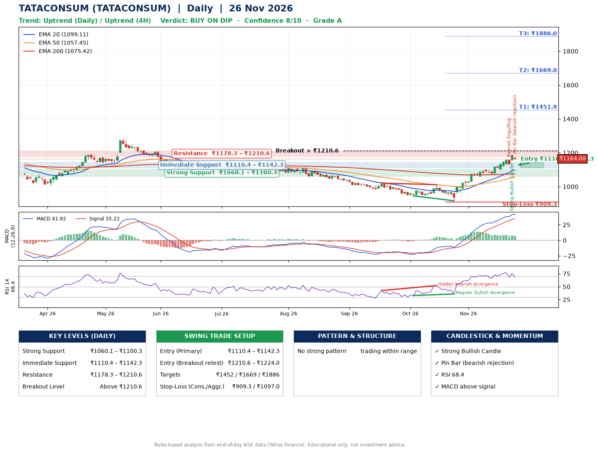

📌 **TATACONSUM (TATACONSUM) – Multi-Timeframe Technical Analysis (Daily + 4H Combined)**
_Data up to 26 Nov 2026 · Close ₹1164.00_

**📍 Daily Timeframe Trend**
- Trend: **Uptrend** (price above rising EMAs)
- Recent swing highs: ₹1123.4, ₹1020.3, ₹1011.2 · swing lows: ₹945.0, ₹945.0, ₹916.0
- EMAs: EMA20 ₹1099.1, EMA50 ₹1057.5, EMA200 ₹1075.4; mixed / crossing; price above EMA20, EMA50, EMA200
- MACD 41.92 above signal 35.22 (above zero); histogram falling
- RSI(14) 68.4; Regular bullish divergence; Hidden bearish divergence

**📍 4-Hour Timeframe Trend**
- Structure: **Uptrend** (higher highs and higher lows)
- Pullback/support area: recent 4H swing lows ₹1076.1, ₹1132.9; EMA20 ₹1132.0
- EMA20/50: bullish stack (EMA20 > EMA50); price above EMA20, EMA50
- MACD 28.44 above signal 28.06 (above zero), fresh bullish crossover; histogram falling
- RSI(14) 66.4; Hidden bullish divergence

**📍 Pattern Detection (Both Timeframes)**
- No strong pattern detected. Trading within range.

**📍 Candlestick Patterns (last 3 daily candles)**
- **Bearish Engulfing** – 23 Nov: sellers fully reversed the prior green candle
- **Strong Bullish Candle** – 25 Nov: wide-range green candle, buyers in control
- **Pin Bar (bearish rejection)** – 26 Nov: long upper wick shows selling near ₹1178.3

**📍 Price Action Key Levels (Daily Structure)**

| Zone | Price Level (₹) | Context |
|------|-----------------|---------|
| Strong Support | ₹1060.1 – ₹1100.3 | Cluster of earlier swing lows (demand) |
| Immediate Support | ₹1110.4 – ₹1142.3 | Nearest swing-low / wick area |
| Resistance | ₹1178.3 – ₹1210.6 | Nearest swing-high supply |
| Breakout Level | Above ₹1210.6 | Swing continuation trigger (52-week high ₹1282.7) |

**📍 Swing Trade Setup**

🟢 **Entry Zone**
- Primary: ₹1110.4 – ₹1142.3 (daily support / EMA20 area; enter on a bullish 4H candle)
- Alternate: ₹1210.6 – ₹1224.0 (breakout retest)

🎯 **Profit Targets**
- T1: ₹1451.9
- T2: ₹1669.0
- T3: ₹1886.0

🛑 **Stop-Loss**
- Conservative: below daily swing low (₹909.3)
- Aggressive: below 4H structure (₹1097.0)
- Risk per share ≈ ₹217.1; reward:risk to T1 ≈ 1.5
- Time to T1: it never rose this much within 60 trading days in the price history
- Time to T2: it never rose this much within 60 trading days in the price history

**📌 Strategy Notes**
- Higher timeframe: daily trend is uptrend; only take longs while price holds above ₹1060.1.
- Entry timing: wait for a bullish 4H candle (engulfing/hammer) inside ₹1110.4 – ₹1142.3 rather than buying mid-range.
- EMA stacking: mixed / crossing; price above EMA20, EMA50, EMA200.
- Breakout rule: a daily close above ₹1210.6 with volume above its 20-day average (≈1,569,145) opens T2/T3.
- Momentum: RSI 68 – elevated, prefer dips; Regular bullish divergence; Hidden bearish divergence.
- Exit discipline: move the stop to entry once T1 is hit; book partial profits at each target.

**STEP 2 — Marked Up Chart**

**✅ Trade Validation Checklist**
- Trend + momentum aligned: Yes · Price at entry zone: No
- Stop defined (₹909.3) · Reward:risk ≥ 1.5 to T1: No

## 📌 Final Verdict

Recommendation: **🟡 BUY ON DIP**

Confidence: **8/10**

Trade Quality: **A**

Reason:
• Daily uptrend (price above rising EMAs)

Next Action:
• Wait for a pullback to ₹1110.4–₹1142.3, or a breakout above ₹1210.6

_Rules-based analysis from end-of-day data. Educational only, not investment advice. Never place orders without your own confirmation._