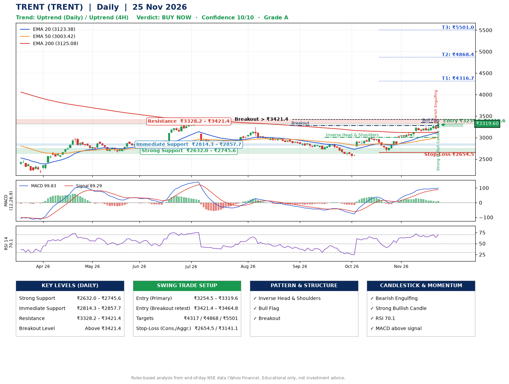

📌 **TRENT (TRENT) – Multi-Timeframe Technical Analysis (Daily + 4H Combined)**
_Data up to 25 Nov 2026 · Close ₹3319.60_

**📍 Daily Timeframe Trend**
- Trend: **Uptrend** (higher highs and higher lows)
- Recent swing highs: ₹3244.5, ₹2847.9, ₹3004.7 · swing lows: ₹2723.9, ₹2545.8, ₹2676.2
- EMAs: EMA20 ₹3123.4, EMA50 ₹3003.4, EMA200 ₹3125.1; mixed / crossing; price above EMA20, EMA50, EMA200
- MACD 99.83 above signal 89.29 (above zero); histogram rising
- RSI(14) 70.1; no divergence on the last two swings

**📍 4-Hour Timeframe Trend**
- Structure: **Uptrend** (higher highs and higher lows)
- Pullback/support area: recent 4H swing lows ₹3145.2, ₹3146.8; EMA20 ₹3201.9
- EMA20/50: bullish stack (EMA20 > EMA50); price above EMA20, EMA50
- MACD 61.23 above signal 60.42 (above zero), fresh bullish crossover; histogram rising
- RSI(14) 70.7; Hidden bullish divergence; Regular bearish divergence

**📍 Pattern Detection (Both Timeframes)**
- Daily: **Inverse Head & Shoulders** – head ₹2545.8, neckline ₹3004.7
- Daily: **Bull Flag** – 15% pole then a tight 6% flag; trigger above ₹3349.9
- Daily: **Breakout** – closed above the 60-session high ₹3280.0 on strong volume

**📍 Candlestick Patterns (last 3 daily candles)**
- **Bearish Engulfing** – 23 Nov: sellers fully reversed the prior green candle
- **Strong Bullish Candle** – 25 Nov: wide-range green candle, buyers in control

**📍 Price Action Key Levels (Daily Structure)**

| Zone | Price Level (₹) | Context |
|------|-----------------|---------|
| Strong Support | ₹2632.0 – ₹2745.6 | Cluster of earlier swing lows (demand) |
| Immediate Support | ₹2814.3 – ₹2857.7 | Nearest swing-low / wick area |
| Resistance | ₹3328.2 – ₹3421.4 | Nearest swing-high supply |
| Breakout Level | Above ₹3421.4 | Swing continuation trigger (52-week high ₹4417.8) |

**📍 Swing Trade Setup**

🟢 **Entry Zone**
- Primary: ₹3254.5 – ₹3319.6 (daily support / EMA20 area; enter on a bullish 4H candle)
- Alternate: ₹3421.4 – ₹3464.8 (breakout retest)

🎯 **Profit Targets**
- T1: ₹4316.7
- T2: ₹4868.4
- T3: ₹5501.0

🛑 **Stop-Loss**
- Conservative: below daily swing low (₹2654.5)
- Aggressive: below 4H structure (₹3141.1)
- Risk per share ≈ ₹632.5; reward:risk to T1 ≈ 1.6
- Time to T1: about 55 trading days (it rose this much within 60 trading days 4% of the time in the last 2 years)
- Time to T2: about 57 trading days (it rose this much within 60 trading days 0% of the time in the last 2 years)

**📌 Strategy Notes**
- Higher timeframe: daily trend is uptrend; only take longs while price holds above ₹2632.0.
- Entry timing: wait for a bullish 4H candle (engulfing/hammer) inside ₹3254.5 – ₹3319.6 rather than buying mid-range.
- EMA stacking: mixed / crossing; price above EMA20, EMA50, EMA200.
- Breakout rule: a daily close above ₹3421.4 with volume above its 20-day average (≈1,055,820) opens T2/T3.
- Momentum: RSI 70 – elevated, prefer dips; no divergence on the last two swings.
- Exit discipline: move the stop to entry once T1 is hit; book partial profits at each target.

**STEP 2 — Marked Up Chart**

**✅ Trade Validation Checklist**
- Trend + momentum aligned: Yes · Price at entry zone: Yes
- Stop defined (₹2654.5) · Reward:risk ≥ 1.5 to T1: Yes

## 📌 Final Verdict

Recommendation: **🟢 BUY NOW**

Confidence: **10/10**

Trade Quality: **A**

Reason:
• Daily uptrend (higher highs and higher lows)
• Inverse Head & Shoulders: head ₹2545.8, neckline ₹3004.7

Next Action:
• Buy now within the entry zone, with the stop-loss in place

_Rules-based analysis from end-of-day data. Educational only, not investment advice. Never place orders without your own confirmation._