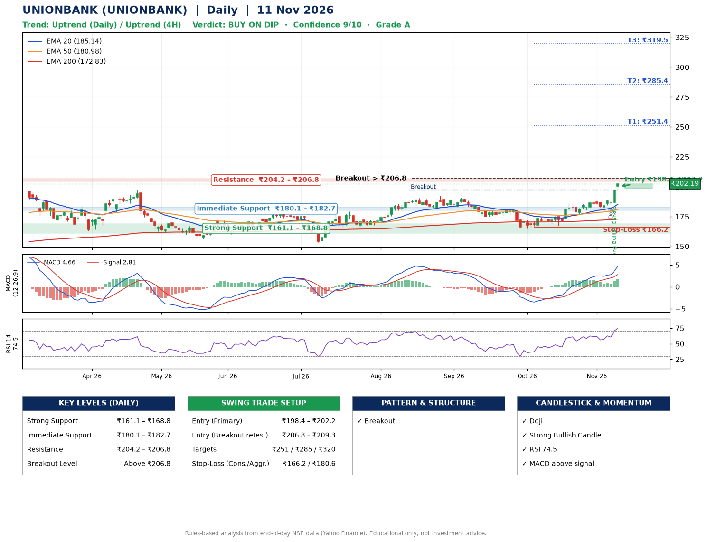

📌 **UNIONBANK (UNIONBANK) – Multi-Timeframe Technical Analysis (Daily + 4H Combined)**
_Data up to 11 Nov 2026 · Close ₹202.19_

**📍 Daily Timeframe Trend**
- Trend: **Uptrend** (higher highs and higher lows)
- Recent swing highs: ₹190.8, ₹180.7, ₹186.0 · swing lows: ₹174.7, ₹164.8, ₹167.5
- EMAs: EMA20 ₹185.1, EMA50 ₹181.0, EMA200 ₹172.8; bullish stack (EMA20 > EMA50 > EMA200); price above EMA20, EMA50, EMA200
- MACD 4.66 above signal 2.81 (above zero); histogram rising
- RSI(14) 74.5; no divergence on the last two swings

**📍 4-Hour Timeframe Trend**
- Structure: **Uptrend** (higher highs and higher lows)
- Pullback/support area: recent 4H swing lows ₹177.3, ₹180.9; EMA20 ₹188.6
- EMA20/50: bullish stack (EMA20 > EMA50); price above EMA20, EMA50
- MACD 4.47 above signal 3.05 (above zero), fresh bullish crossover; histogram rising
- RSI(14) 79.8; Hidden bullish divergence

**📍 Pattern Detection (Both Timeframes)**
- Daily: **Breakout** – closed above the 60-session high ₹197.1 on strong volume
- 4H: **Double Bottom** – bottoms near ₹177.3/₹180.9, neckline ₹188.6, confirmed (closed above neckline)

**📍 Candlestick Patterns (last 3 daily candles)**
- **Doji** – 06 Nov: indecision; wait for the next candle to confirm direction
- **Strong Bullish Candle** – 09 Nov: wide-range green candle, buyers in control

**📍 Price Action Key Levels (Daily Structure)**

| Zone | Price Level (₹) | Context |
|------|-----------------|---------|
| Strong Support | ₹161.1 – ₹168.8 | Cluster of earlier swing lows (demand) |
| Immediate Support | ₹180.1 – ₹182.7 | Nearest swing-low / wick area |
| Resistance | ₹204.2 – ₹206.8 | Nearest swing-high supply |
| Breakout Level | Above ₹206.8 | Swing continuation trigger (52-week high ₹205.5) |

**📍 Swing Trade Setup**

🟢 **Entry Zone**
- Primary: ₹198.4 – ₹202.2 (daily support / EMA20 area; enter on a bullish 4H candle)
- Alternate: ₹206.8 – ₹209.3 (breakout retest)

🎯 **Profit Targets**
- T1: ₹251.4
- T2: ₹285.4
- T3: ₹319.5

🛑 **Stop-Loss**
- Conservative: below daily swing low (₹166.2)
- Aggressive: below 4H structure (₹180.6)
- Risk per share ≈ ₹34.1; reward:risk to T1 ≈ 1.5

**📌 Strategy Notes**
- Higher timeframe: daily trend is uptrend; only take longs while price holds above ₹161.1.
- Entry timing: wait for a bullish 4H candle (engulfing/hammer) inside ₹198.4 – ₹202.2 rather than buying mid-range.
- EMA stacking: bullish stack (EMA20 > EMA50 > EMA200); price above EMA20, EMA50, EMA200.
- Breakout rule: a daily close above ₹206.8 with volume above its 20-day average (≈18,653,567) opens T2/T3.
- Momentum: RSI 74 – elevated, prefer dips; no divergence on the last two swings.
- Exit discipline: move the stop to entry once T1 is hit; book partial profits at each target.

**STEP 2 — Marked Up Chart**

**✅ Trade Validation Checklist**
- Trend + momentum aligned: Yes · Price at entry zone: Yes
- Stop defined (₹166.2) · Reward:risk ≥ 1.5 to T1: Yes

## 📌 Final Verdict

Recommendation: **🟡 BUY ON DIP**

Confidence: **9/10**

Trade Quality: **A**

Reason:
• Daily uptrend (higher highs and higher lows)
• EMAs stacked bullishly

Next Action:
• Wait for a pullback to ₹198.4–₹202.2, or a breakout above ₹206.8

_Rules-based analysis from end-of-day data. Educational only, not investment advice. Never place orders without your own confirmation._