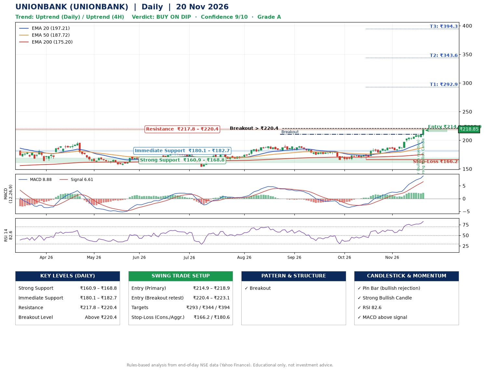

📌 **UNIONBANK (UNIONBANK) – Multi-Timeframe Technical Analysis (Daily + 4H Combined)**
_Data up to 20 Nov 2026 · Close ₹218.85_

**📍 Daily Timeframe Trend**
- Trend: **Uptrend** (higher highs and higher lows)
- Recent swing highs: ₹190.8, ₹180.7, ₹186.0 · swing lows: ₹174.7, ₹164.8, ₹167.5
- EMAs: EMA20 ₹197.2, EMA50 ₹187.7, EMA200 ₹175.2; bullish stack (EMA20 > EMA50 > EMA200); price above EMA20, EMA50, EMA200
- MACD 8.88 above signal 6.61 (above zero); histogram rising
- RSI(14) 82.6; no divergence on the last two swings

**📍 4-Hour Timeframe Trend**
- Structure: **Uptrend** (higher highs and higher lows)
- Pullback/support area: recent 4H swing lows ₹177.3, ₹180.9; EMA20 ₹204.4
- EMA20/50: bullish stack (EMA20 > EMA50); price above EMA20, EMA50
- MACD 7.24 above signal 6.37 (above zero); histogram rising
- RSI(14) 85.5; Hidden bullish divergence

**📍 Pattern Detection (Both Timeframes)**
- Daily: **Breakout** – closed above the 60-session high ₹210.6 on strong volume
- 4H: **Double Bottom** – bottoms near ₹177.3/₹180.9, neckline ₹188.6, confirmed (closed above neckline)

**📍 Candlestick Patterns (last 3 daily candles)**
- **Pin Bar (bullish rejection)** – 18 Nov: long lower wick shows dip-buying near ₹204.1
- **Strong Bullish Candle** – 20 Nov: wide-range green candle, buyers in control

**📍 Price Action Key Levels (Daily Structure)**

| Zone | Price Level (₹) | Context |
|------|-----------------|---------|
| Strong Support | ₹160.9 – ₹168.8 | Cluster of earlier swing lows (demand) |
| Immediate Support | ₹180.1 – ₹182.7 | Nearest swing-low / wick area |
| Resistance | ₹217.8 – ₹220.4 | Nearest swing-high supply |
| Breakout Level | Above ₹220.4 | Swing continuation trigger (52-week high ₹219.1) |

**📍 Swing Trade Setup**

🟢 **Entry Zone**
- Primary: ₹214.9 – ₹218.9 (daily support / EMA20 area; enter on a bullish 4H candle)
- Alternate: ₹220.4 – ₹223.1 (breakout retest)

🎯 **Profit Targets**
- T1: ₹292.9
- T2: ₹343.6
- T3: ₹394.3

🛑 **Stop-Loss**
- Conservative: below daily swing low (₹166.2)
- Aggressive: below 4H structure (₹180.6)
- Risk per share ≈ ₹50.7; reward:risk to T1 ≈ 1.5
- Time to T1: about 53 trading days (it rose this much within 60 trading days 5% of the time in the last 2 years)
- Time to T2: it never rose this much within 60 trading days in the price history

**📌 Strategy Notes**
- Higher timeframe: daily trend is uptrend; only take longs while price holds above ₹160.9.
- Entry timing: wait for a bullish 4H candle (engulfing/hammer) inside ₹214.9 – ₹218.9 rather than buying mid-range.
- EMA stacking: bullish stack (EMA20 > EMA50 > EMA200); price above EMA20, EMA50, EMA200.
- Breakout rule: a daily close above ₹220.4 with volume above its 20-day average (≈15,521,538) opens T2/T3.
- Momentum: RSI 83 – elevated, prefer dips; no divergence on the last two swings.
- Exit discipline: move the stop to entry once T1 is hit; book partial profits at each target.

**STEP 2 — Marked Up Chart**

**✅ Trade Validation Checklist**
- Trend + momentum aligned: Yes · Price at entry zone: Yes
- Stop defined (₹166.2) · Reward:risk ≥ 1.5 to T1: No

## 📌 Final Verdict

Recommendation: **🟡 BUY ON DIP**

Confidence: **9/10**

Trade Quality: **A**

Reason:
• Daily uptrend (higher highs and higher lows)
• EMAs stacked bullishly

Next Action:
• Wait for a pullback to ₹214.9–₹218.9, or a breakout above ₹220.4

_Rules-based analysis from end-of-day data. Educational only, not investment advice. Never place orders without your own confirmation._